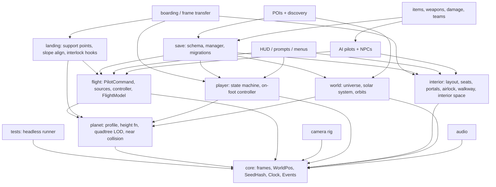

# Sol — Architecture

**Status:** decided plan; M0-M5 are implemented (see MILESTONES.md for what is verified). Where the code differs from this text, the ADRs in `docs/decisions/` win.
**Engine:** Godot 4.7.2 Forward+, GDScript (static typing), Jolt physics.
**Target:** macOS, Mac mini M4, 16 GB unified memory.
**Goal:** an independently implemented game that recreates Rodina's connected loop —
space → atmosphere → landing → on foot → airlock → ship interior → pilot seat → takeoff —
and then grows toward Rodina's full breadth (multiple worlds, POIs, interiors, AI, combat,
progression, ship layout). Not a demo.

Companion files: [`MILESTONES.md`](MILESTONES.md) (checklist + acceptance tests),
[`../ATTRIBUTION.md`](../ATTRIBUTION.md) (asset/code licence register),
research in [`../research/rodina-starfall-reference/`](../research/rodina-starfall-reference/).

---

## 0. Facts this plan rests on

Labels: **[V]** verified during planning, **[R-C]** research says confirmed in Rodina source,
**[R-I]** research inference, **[D]** Sol design decision (not a Rodina fact), **[?]** unknown.

| Fact | Label | How it was checked |
|---|---|---|
| Sol repo held only the research library (1 commit, `7e6d95b`) | V | `git log`, file listing |
| Godot 4.7.2 stable exists (released 2026-08-18) | V | web search: godotengine.org/article/maintenance-release-godot-4-7-2 |
| Jolt is the default 3D physics for new projects since 4.6 | V | web search: godotengine.org/releases/4.6 |
| Double-precision Godot needs a custom `precision=double` build | V | web search: Godot docs "Large world coordinates" |
| GDScript `float` is 64-bit; `Vector3` is 32-bit in standard builds | V (Godot docs, not re-fetched) | Godot docs; re-check with a test in M0 |
| Cloud container: Linux x86_64, no GPU, **no Godot**, Godot/GitHub downloads blocked | V | `which godot`, `/dev/dri` absent, curl → proxy 403 |
| Cuberact "Procedural Planet – Chunked LOD" is MIT, Godot 4.3, GDScript | V (listing only) | Godot Asset Library listing; LICENSE file **not read** |
| Quaternius Modular Sci-Fi MegaKit is CC0 | V (listing only) | itch.io / OpenGameArt listing |
| Kenney Modular Space Kit is CC0 | V (listing only) | OpenGameArt listing |
| GdUnit4 is MIT | V (third-party listing only) | not confirmed on its repo |
| Human and AI fill one pilot interface; one consumer applies it | R-C | `02` §3, FLY-01..04 |
| Control authority ≠ camera target | R-I (strong) | `02` §4.2, FLY-17 |
| Landed = contact distance + 1 m and speed < 4 m/s | R-C | FLY-26 |
| POI rings 10 km / 3.5 km / 100 m | R-C | PRC-05 |
| Gear speeds 100 / 500 / 5–10k / 30k m/s | R-C | FLY-12 |
| Atmosphere 200 km, entry ratio <1, inside <0.5, 4 s timer | R-C | FLY-27, `04` §5 |
| Gravity = surface_g / (r/R)² | R-C | PLN-17 |
| Planet radii 4,000–10,000 km | R-C | PLN-02 |
| Airlock interlock in Rodina is disabled code; engine behaviour unknown | R-C / ? | INT-11, G1 |
| Terrain mesh/LOD/collision, origin shift, seating, boarding are engine-side in Rodina | ? | E1–E8 |

**Consequence of the last row:** for everything Rodina hides in C++, Sol designs its own
system. The research is guidance for *what the game does*, not *how*.

**Starfall:** the research guide (`08`) was written for Starfall, an existing project. Sol is a
separate, empty project. Starfall must never be modified. Starfall is the user's own code and
may be read for tuned values, but Sol does not depend on it. Anything copied from Starfall that
originated in third-party code (e.g. the cuberact addon) carries that licence into
`ATTRIBUTION.md`.

---

## 1. Execution environment (where work can happen)

| Work | Cloud session (this one) | Mac mini M4 |
|---|---|---|
| Write/edit docs, GDScript, data | yes | yes |
| Run Godot, headless tests | **no** (Godot not installable here) | yes: `godot --headless` |
| Play/visual/perf tests | no | yes |

So **every milestone's acceptance tests must be run on the Mac.** A cloud session may write
code but must say "not run" for every test it could not execute. If the cloud environment is
later given network access to `downloads.godotengine.org` / `github.com`, a Linux
headless Godot could run the logic tests here too (not visual or performance tests).

---

## 2. Top-level architecture

### 2.1 Chosen shape and why

1. **GDScript only** (typed). No C#/GDExtension until profiling proves a hotspot (most
   likely terrain meshing). Reason: no native toolchain, fast iteration, headless-testable.
2. **Pure logic separated from nodes.** Every rule that can be tested without a scene
   (pilot math, seat occupancy, airlock state machine, seed hashing, save schema, landing
   decisions) lives in `RefCounted` classes under `src/core/` or each system's `logic/`.
   Nodes are thin adapters. This is what makes headless regression tests possible.
3. **One owner per piece of state** (from research `08` §1.4). Player posture/location/
   authority, pilot authority, seat occupancy, door state, pressure, POI state, save state.
4. **Intent → actuation.** Anything that moves a ship produces a `PilotCommand`; the ship's
   `FlightModel` is the only consumer (Rodina's strongest confirmed pattern, FLY-01..04).
5. **Frames, not one giant world.** Precision is handled by a reference-frame hierarchy +
   floating origin (§4), not double-precision engine builds.
6. **Separate interior physics space.** Walking inside a moving ship happens in a ship-local
   physics space that never moves (§7). Visual player is placed by transform.
7. **Data-driven content.** Ships, planets, POIs, interiors, items are `Resource` files
   (`.tres`) with typed exports. No hard-coded tables in scripts.
8. **Single-player first, authority-clean.** All state changes go through controller APIs
   (`request_*` → result). No networking now; the API shape allows it later.

### 2.2 Project layout

```text
Sol/
├── project.godot
├── CLAUDE.md                # agent rules for this repo
├── ATTRIBUTION.md           # licence register (every third-party file)
├── docs/                    # ARCHITECTURE.md, MILESTONES.md, decisions/ (ADRs)
├── research/                # read-only reference; never imported by the game
├── addons/                  # vendored third-party code, each with its LICENSE
├── assets/                  # third-party + original art/audio, by source
│   └── <source>/<pack>/...  # e.g. assets/quaternius/scifi_megakit/
├── data/                    # .tres content: ships/, planets/, pois/, interiors/, items/
├── src/
│   ├── core/                # frames, world position, seed hash, clock, events, util
│   ├── flight/              # pilot command/sources/controller, flight model, landing
│   ├── planet/              # terrain profile, height function, quadtree, chunks, atmosphere
│   ├── player/              # player state machine, on-foot controller, avatar
│   ├── interior/            # layout, rooms, portals, airlock, seats, occupancy, walkway
│   ├── world/               # universe, solar system, POIs, discovery
│   ├── save/                # schema, manager, migrations
│   ├── camera/              # camera rig + modes
│   ├── ui/                  # HUD, prompts, menus
│   ├── audio/               # buses, sound service
│   └── debug/               # overlay, console, test hooks
├── scenes/                  # .tscn; main.tscn is the only boot scene
└── tests/
    ├── run_tests.gd         # headless runner (SceneTree script)
    ├── unit/                # pure logic
    ├── scenario/            # scripted multi-frame simulations, headless
    └── fixtures/            # recorded commands, golden hashes, save files
```

### 2.3 Dependency map

Arrows mean "depends on". Build bottom-up.



### 2.4 Autoloads (global services) — keep this list short

| Autoload | Owns |
|---|---|
| `Sol` | world seed, game clock, pause state, references to active Universe/Player/Ship |
| `Events` | typed signals that cross systems (landed_changed, poi_discovered, …) |
| `SaveService` | save/load/autosave |
| `Settings` | user settings in `user://settings.cfg` (not in saves) |

Everything else is a node owned by the scene that uses it.

---

## 3. Spaceflight and shared pilot control

**Interfaces**

```gdscript
class_name PilotCommand extends RefCounted   # src/flight/pilot_command.gd
var thrust: Vector3        # ship-local, -1..1, Godot axes (x right, y up, -z forward)
var turn: Vector3          # pitch, yaw, roll rate demand, -1..1
var face_dir: Vector3      # optional: desired forward dir (AI); ZERO = use turn
var gear: int              # 0 DOCK, 1 COMBAT, 2 CRUISE, 3 WARP (later)
var boost: bool
var brake: bool            # flight-assist hard stop
var lock_linear: bool
var tick: int
var source_id: StringName

class_name PilotSource extends RefCounted    # player / AI / scripted / replay
func poll(state: ShipState, delta: float) -> PilotCommand

# src/flight/pilot_controller.gd (child of Ship)
func request_control(source: PilotSource, seat_id: StringName) -> ControlResult
func release_control(source: PilotSource) -> void
signal control_changed(old_source, new_source)

# src/flight/flight_model.gd (pure logic)
static func step(state: ShipState, cmd: PilotCommand, env: FlightEnvironment, delta: float) -> ShipState
```

- `ShipState` (pure data): planet-frame position (doubles), velocity, orientation (Basis),
  angular velocity, gear, landed flags. `FlightEnvironment`: gravity vector, atmosphere ratio,
  terrain query callable.
- Flight model *(ADR 0008; rules and evidence in `docs/RODINA_PHYSICS_AUDIT.md`)*: Sol's implementation of
  Rodina 1.6.2's `EGVehicle` rules. Thrust steers the velocity toward a target at a limited rate and no input
  applies nothing (momentum kept; drag only far over the gear speed); turn input is angular acceleration with
  friction only while coasting and only in air; per-gear table from `EGDataShipPlayer`; ships feel planet
  gravity x 3.5; entry resistance only while entering; roll-only levelling in the air (a setting). AI facing
  sets the turn rate directly; AI/scripted pilots hold velocity with `move_lock`. No altitude-triggered
  attitude rule. Gears: PRECISION (Sol's: scaled dock gear with station keeping and hover), COMBAT (Rodina's),
  CRUISE (Rodina's in-air speeds; above the air distance-scaled, Sol's stand-in for relative time); the chosen
  gear is kept in `ShipState.selected_gear` and the allowed one applied each tick.
- **Fixed 60 Hz physics tick; flight runs in `_physics_process` only.** Deterministic given
  the same command stream → replay tests.
- High-speed safety: at cruise (up to 10 km/s ≈ 167 m per tick) each step sweeps the segment
  against the terrain height function and the atmosphere shell; clamp on hit.
- No pilot → ship is `PARKED` (holds velocity in space, damps to rest when landed), never
  `set_process(false)`.

**Risks:** flight feel → tune with data in `data/ships/*.tres`, record command fixtures early.
Jitter at speed → camera interpolation from physics state, floating origin (§4).

**Acceptance:** command replay of a recorded 10 s run reproduces final position within 1e-3 m;
second `request_control` is denied with a reason; AI source flies to a point 5 km away and
stops within 50 m; cruise at 10 km/s toward terrain never tunnels.

---

## 4. Planets: terrain, collision, LOD, precision, origin shifting

### 4.1 Frames and precision [D]

- `WorldPos` = `{frame_id, x, y, z}` with GDScript `float` (64-bit). Authoritative for ships,
  player, POIs, save data.
- **Active frame** = the planet whose sphere of influence the player is in (activation radius
  `10 × R`, same order as Rodina PRC-01). In that frame the planet is fixed and non-rotating
  as far as physics is concerned; the sun, sky and other bodies move around it. Planet rotation
  and orbits are analytic functions of game time (Rodina has no n-body, `04` §2.3).
- **Floating origin:** the render/physics origin follows the camera anchor; when it is more
  than `ORIGIN_REBASE_DISTANCE` (start 1,024 m) away, everything in group `origin_shift` is
  moved by the offset between physics ticks. Float32 at ≤ 2 km from origin is sub-millimetre.
- Each terrain chunk node sits at its own centre; vertices are chunk-local (small numbers).
- Frame switch (leaving a planet's SOI): convert all `WorldPos` to the system frame, rebuild.

### 4.2 Terrain [D, informed by `04` §3]

- **One CPU height function is the single source of truth.** `TerrainProfile` (Resource):
  radius, height range, sea level, warp, continent/plateau/mountain/crater weights, seeds,
  palette, material bands. `HeightFunction.height(dir: Vector3, profile) -> float` (metres).
- Noise via `FastNoiseLite` (native, fast). **Precision rule:** sample noise with the unit
  direction scaled by octave frequency, never with metre-scale planet coordinates (float32
  inside FastNoiseLite would destroy fine octaves at 6,000 km).
- **No GPU displacement.** Heights and normals are baked into chunk vertices on the CPU; the
  shader only colours (altitude/latitude/slope/feature masks, the Rodina six-gate idea,
  PLN-10). This removes any CPU/GPU height mismatch by construction.
- **Quadtree cube-sphere LOD:** 6 faces, split by screen-space/ distance metric, 33×33
  vertex chunks, skirts to hide cracks, generation on `WorkerThreadPool`, at most N mesh
  uploads per frame. Start from the MIT cuberact addon **as reference or vendored code** after
  reading its LICENSE on the Mac; wrap behind Sol's `PlanetTerrain` interface so it can be
  replaced.
- **Collision:** only for max-LOD chunks within ~1.5 km of a physics actor (ship or player):
  `ConcavePolygonShape3D` built on a worker thread. Ship terrain contact additionally uses
  direct height queries at support points (cheap, works at any distance).
- `TerrainModifier` (flatten pads for POIs/structures, inner/outer radius, Rodina INT-27
  concept) applied inside the height function, so mesh, collision and queries agree.

**Interfaces:** `PlanetBody.height_at(dir)`, `surface_point(dir)`, `normal_at(dir)`,
`gravity_at(world_pos)`, `atmosphere_ratio(world_pos)`, `PlanetTerrain.set_focus(points)`.

**Risks:** GDScript meshing too slow → worker threads, fewer octaves, then a GDExtension
only if profiled; LOD popping → morphing later; collision lag under fast descent → collision
ring larger than the ship can cover in the generation time, fall back to height-query contact.

**Acceptance:** height function deterministic across runs (golden hash of 1,000 samples);
at a 6,000 km radius the player stands still for 60 s with drift < 1 cm; descent from 300 km to
landing shows no cracks and no fall-through; collision mesh vs height query error < 0.1 m.

---

## 5. Gravity and on-foot movement

- Gravity source per frame context: **planet** (toward centre, `g/(r/R)²`, PLN-17) outside;
  **ship artificial gravity** (ship-local down, 1 g) inside the interior space [D — Rodina's
  interior gravity is not documented].
- `OnFootController` = `CharacterBody3D` with `up_direction` set every tick from the gravity
  vector, body basis slerped to stay upright, walk/run/jump/crouch, slope limit, step-up.
  Movement constants are data (Rodina keeps them per character, PLN-18).
- Gravity blend zone (ramp/airlock): up vector slerps over ~0.3 s when the gravity source
  changes; never instant.
- Jetpack is a later milestone (Rodina has one; `04` §6).

**Acceptance:** walk 2 km in a straight line on a 6,000 km planet: stays upright, no jitter,
no fall-through; jump lands within 5 cm of predicted; slopes above the limit block.

---

## 6. Continuous transitions

`PlayerState` (pure logic) with three orthogonal axes (from research `08` §3):

- **Posture:** STANDING, SITTING_DOWN, SEATED, STANDING_UP
- **Location:** EXTERIOR(planet/space), INTERIOR(ship_id, room_id), TRANSFER(portal_id)
- **Authority:** NONE, PILOT, PASSENGER (REMOTE_PILOT, AI handover later)

`PlayerStateMachine.try_*()` returns `TransitionResult` (`OK`, `BLOCKED_OCCUPIED`,
`BLOCKED_DOOR`, `BLOCKED_MOVING`, `BLOCKED_AUTHORITY`, `BLOCKED_EXIT`) with a message for the
UI. **No teleports:** every location change is a frame transfer that preserves world-space
position and velocity.

Flight regimes are ship state, not modes the player chooses: SPACE → ENTERING (ratio < 1) →
ATMOSPHERE (ratio < 0.5, 4 s entry timer) → NEAR_GROUND → LANDED and back (FLY-27). The
camera, audio and HUD react to these via `Events`.

**Acceptance:** 100 randomized transition sequences (sit/stand/board/exit/fly/land) end in a
legal state with no softlock (scenario test).

---

## 7. Ship interiors, seats, doors, airlocks, interlocks

### 7.1 Interior space [D — Rodina's interior runtime is engine-side, E6–E7]

- Each ship owns an `InteriorSpace`: a `SubViewport` with `own_world_3d = true`, rendering
  disabled, holding **only interior collision** (floors, walls, doors) and the player's
  `OnFootController` while inside. It never moves, so walking is stable at any ship speed or
  rotation and across origin rebases.
- The visible interior meshes and the player avatar render in the main world as children of
  the ship; the avatar copies `ship.global_transform * interior_local_transform` each frame.
- **Spike first (M3.0):** confirm on the Mac that a `CharacterBody3D` in a separate
  `World3D` works headless and with rendering off. **Fallback:** player stays in the main world
  as a child of the ship with ship-relative kinematic movement and shape queries (Starfall's
  approach per `08` §0). Decide by the spike, record in `docs/decisions/`.

### 7.2 Layout and state

- `InteriorLayout` (Resource): rooms (`room_id`, bounds, volume), portals (`portal_id`,
  room_a, room_b, kind DOOR/AIRLOCK_INNER/AIRLOCK_OUTER/HATCH), seats (`seat_id`, role,
  enter/exit transforms), spawn points. IDs are authored strings, used by saves.
- `SeatManager`: reserve/release, one occupant per seat. Pilot seat links to the
  `PilotController`; sitting in it requests control.
- `Portal`: `open_factor`, `locked`; `can_open()` checks doorway occupancy, airlock partner,
  pressure difference.
- `AirlockController` state machine: SEALED, INNER_OPENING/OPEN, OUTER_OPENING/OPEN, CYCLING.
  Invariant: never both doors open (Rodina's interlock is disabled code, INT-11; Sol enforces it).
- `WalkwayController`: STOWED, DEPLOYING, DEPLOYED, RETRACTING, BLOCKED; deploy only when
  landed and slow (Rodina hysteresis 75/500 speed², FLY-31); ramp end fitted to terrain.
- **Interlocks** (Sol rules, Rodina mostly lacks them): no takeoff with walkway occupied or
  outer door open (auto-close if empty); no outer door open above 2 m/s; standing up from
  the pilot seat while airborne leaves the ship PARKED (and warns in atmosphere).
- Pressure: scalar per room, added after door parity (M8), affects doors and FX.

**Acceptance:** 10,000-step random door requests never open both airlock doors; seat cannot
have two occupants; takeoff blocked with walkway occupied; walk every interior room while the
ship flies at 500 m/s and rolls: no clipping, no drift.

---

## 8. Deterministic procedural locations and discovery

- `SeedHash` (pure logic): 32-bit integer mixing (e.g. PCG/xxhash-style) with every
  intermediate masked `& 0xFFFFFFFF`, so results never depend on 64-bit overflow behaviour.
  Never use `hash()` of strings or global `randf()` for content. Golden fixtures pin outputs.
- Seed chain: `world_seed → planet_seed(planet_id) → poi_seed(planet, index) →
  content_seed(poi, generation_version)`.
- `POIDefinition` (Resource) / `POIInstance` (data: id, def, seed, generation_version,
  planet-local direction, state, discovered, visited, looted, cleared).
- `POIManager` per planet: generate instances as data at planet activation; rings with
  hysteresis — proxy 12/15 km, content 4/6 km, detail 1.5/2.5 km, discover 120 m on foot
  (scaled from Rodina 10 km / 3.5 km / 100 m, PRC-05). Only ring-active POIs have nodes.
- Site scoring + `TerrainModifier` pads so POIs sit on flat ground.
- Discovery keyed by per-instance ID (Rodina's class-name key collides, TRAP-09).

**Acceptance:** same seed → identical POI data hash in fresh processes; 500 POIs planned,
only ring-active ones instantiated; discovery fires once; save→load keeps flags.

---

## 9. Versioned save/load

- JSON (human-debuggable) with `save_version`, `game_version`, `world_seed`, sections:
  `player`, `ships[]`, `interiors{}`, `world`, `pois[]`, `discoveries[]`.
- Positions saved as `WorldPos` (frame id + doubles), never global node transforms.
- Save **state and seeds, not scenes** (`08` §8.3). Interiors save door/seat/walkway/
  pressure by authored ID.
- Atomic write: `slot.tmp` → flush → rename to `slot.json`; previous kept as `slot.bak`;
  SHA-256 of the body stored and checked on load.
- `SaveMigrations.migrate(data)` steps `vN → vN+1`; fixtures of each old version kept in
  `tests/fixtures/saves/` forever.
- Autosave on landing, takeoff, boarding, discovery, every 5 min; never mid-transition
  (deferred until the state machine is stable).

**Acceptance:** save/load in each of: piloting in space, landed seated, standing inside,
outside on terrain, mid-airlock → same state and position (< 1 cm), velocity preserved;
truncated file fails safely and falls back to `.bak`; v1 fixture loads in every later version.

---

## 10. Cameras, UI, animation, sound, feedback

- **CameraRig** (one `Camera3D`): modes CHASE, COCKPIT, ON_FOOT_FIRST, ON_FOOT_THIRD,
  INTERIOR_THIRD; 0.2 s blends; camera follows the *camera target*, independent of who has
  control (FLY-17). Physics interpolation or manual interpolation so 60 Hz physics looks
  smooth at 120 Hz displays.
- **HUD:** speed, altitude/AGL, vertical speed, gear, flight regime, landing status
  ("Too steep"), interaction prompt, discovery toasts, POI markers. Godot `Control` nodes,
  driven by `Events` and state reads, never owning state.
- **Menus:** pause, save/load, settings (mouse sensitivity, invert, FOV, audio, auto-level).
- **Animation:** humanoid with `AnimationTree` (idle/walk/run/jump/sit enter/exit).
  Seat transitions are posture states with locks and cancel.
- **Audio:** buses Master/Music/SFX/UI/Ambience/Interior; engine hum by thrust; wind by
  atmosphere ratio × speed; interior low-pass when inside; landing/door/airlock cues.
  *(N9: recorded samples via `AudioLibrary` replace the synthesised sounds when `GameSettings.sample_audio` is on, with `SoundSynth`
  as the fallback; buses `Ship`, `Suit`, `Radio` are added (UI exists), all following the SFX slider; Interior low-pass is 1200 Hz with
  samples. Ship-placed loops are 2D, scaled by distance to the player, not 3D players. See `docs/N9_STATUS.md`.)*
- **Feedback:** camera shake on touchdown/reentry, FOV with speed, reentry glow.
- **Visual style** *(ADR 0007)*: `VisualStyle` selects `sol` (original look) or `rodina` (Rodina-inspired) from
  `SOL_VISUAL_STYLE`, then `GameSettings.visual_style`; each world gets a `PlanetLook` (terrain colours, detail tiling,
  sky, fog, lights). Styles change colour and light only, never terrain shape, physics or saved state.

---

## 11. Performance budgets (Mac mini M4, 16 GB) [D — targets, not measurements]

| Item | Budget |
|---|---|
| Frame rate | 60 fps minimum at 1440p, high settings |
| Main thread (scripts + scene) | ≤ 8 ms |
| Physics tick (60 Hz) | ≤ 3 ms |
| Terrain chunk uploads | ≤ 4 per frame; generation on worker threads |
| Visible terrain triangles | ≤ 1.5 M |
| Draw calls | ≤ 2,000 |
| Active POI nodes | ≤ 30 |
| Process memory | ≤ 4 GB |
| Save/load | ≤ 200 ms save, ≤ 2 s load to playable |

Each milestone from M1 adds a perf scenario (scripted flight orbit → landing) run on the Mac
with frame-time recorded in `tests/perf/results.md`. A regression > 15 % blocks the milestone.

---

## 12. Testing, regression protection, Git

- **Runner:** `tests/run_tests.gd` (no dependencies): discovers `tests/unit/**/*_test.gd`
  and `tests/scenario/**/*_test.gd`, runs `test_*` methods, prints a summary, exits non-zero on
  failure. Command: `godot --headless --path . -s res://tests/run_tests.gd`.
  GdUnit4 (MIT per listing) can replace it later if needed; not required.
- **Scenario tests** advance a real scene with fixed `delta` for N ticks, using scripted
  `PilotSource`s and scripted on-foot inputs — the whole loop is testable headless.
- **Fixtures:** recorded command streams, golden hashes (height, POIs, seeds), old saves.
- **Manual checklist** per milestone in `MILESTONES.md` (visual/feel items no test covers).
- **Git:** work on a branch per milestone; commit after each green task; tag
  `m<N>-complete` when all acceptance tests pass on the Mac; never commit with failing tests
  without saying so in the message; never force-push `main`.

---

## 13. Reusable technology and assets

| Item | Use | Licence | Status |
|---|---|---|---|
| Godot 4.7.2 + Jolt (built-in) | engine, physics | MIT | verified exists |
| FastNoiseLite (built-in) | terrain noise | MIT (engine) | built-in |
| cuberact planet chunked LOD | quadtree/LOD/origin-shift reference or vendored start | MIT (listing) | read LICENSE before use |
| GdUnit4 | optional test framework | MIT (listing) | optional |
| Quaternius Modular Sci-Fi MegaKit | ship interior modules | CC0 (listing) | check author page at download |
| Kenney Modular Space Kit | props/exterior pieces | CC0 (listing) | check author page at download |
| Characters, animations, SFX, fonts | to be chosen | must be CC0/CC-BY/OFL | **unverified**; pick in M2/M7 and record |
| `assets/sol/**` (materials, decals, sky, audio; N9) | ship, POI, terrain, sky and sound art copied by `tools/import_assets.py` from the Sol-Assets repo (`assets/sol/SOURCE.txt` records its commit and every file's sha256) | Sol original (procedural), no third-party rows | status `review` in Sol-Assets; nobody has seen or heard them in the game yet |

Rules: record every third-party file in `ATTRIBUTION.md` (source URL, author, licence,
date, files) **before** committing it; no Rodina assets, code, or data files ever; no
"free" assets without a licence file.

---

## 14. Major risks

| Risk | Impact | Mitigation |
|---|---|---|
| Godot not available in cloud sessions | tests can't run there | all tests run on Mac; cloud work marked "not run" |
| Float precision at planet scale | jitter, drift | frames + floating origin; precision test in M0/M1 |
| GDScript terrain meshing too slow | stutter, pop-in | worker threads, budgets; GDExtension only after profiling |
| Separate interior physics world misbehaves | interior walking breaks | M3.0 spike; documented fallback |
| Collision missing under fast descent | fall-through | height-query contact as backstop; collision ring sizing |
| Scope creep before loop works | demo with no game | milestones gated; loop (M3) before breadth |
| Rodina-behaviour guessing | wrong design built on unknowns | treat `?` rows as Sol decisions, record in ADRs |
| Asset licence mistakes | legal | `ATTRIBUTION.md` gate on every commit |
| Save format churn | broken saves | versions + migrations + fixtures from M4 |

## Audio content

Sol's audio is event-oriented (`AudioLibrary`/`AudioService`) with a recorded-sample path and a synth
fallback. Reference Rodina SFX live in `assets/sol/audio/rodina/` and are registered under
`rod_*` IDs; see ADR 0010 and `docs/N11_RODINA_AUDIO_MAPPING.md`.

## Planet content

Authored bodies live in `data/planets/*.tres` as `PlanetDefinition` resources; `StarSystem` converts
them to runtime `BodyDef`s and keeps the old in-code construction only as a fallback. See ADR 0009.
