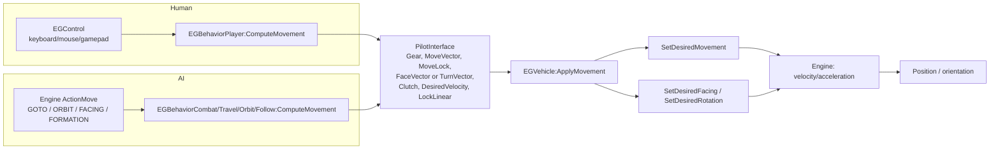
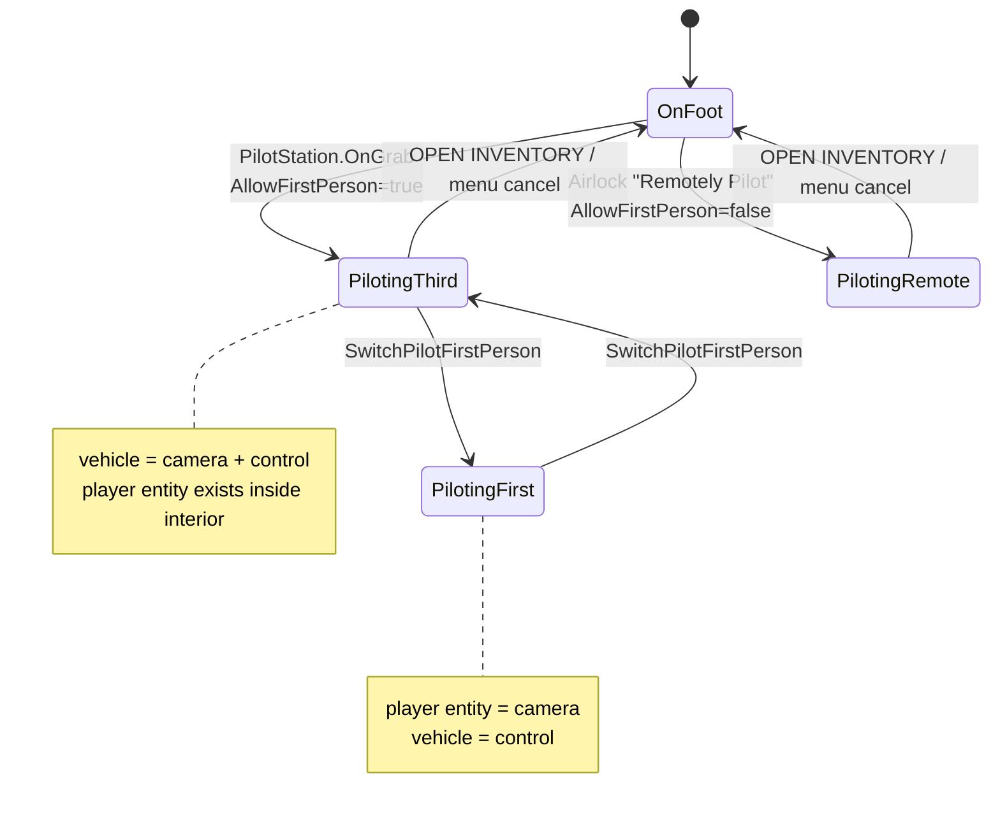

# 02 — Spaceship Flight, Piloting, and Cameras

**Scope:** how Rodina 1.6.2 turns input or AI intent into ship motion; how pilot mode starts and ends; how the player, camera, and ship relate. Static source analysis only. Line numbers are for the extracted tree under
`/Users/arielbowyer/Downloads/Rodina.v1.6.2/Rodina.v1.6.2/`.

**Confidence tags:** `[C]` directly confirmed in Lua source, `[I]` inferred from multiple call sites, `[U]` engine-side or otherwise unverified.

---

## 1. One-paragraph summary

Every ship is an `EGVehicle` (`EGActor` subclass). The same `EGVehicle:ApplyMovement()` consumes a single plain-table **`PilotInterface`** whether it was filled by a human (`EGBehaviorPlayer`) or an AI behaviour (`EGBehaviorCombat`, `EGBehaviorTravel`, …). The interface carries a gear, a desired move vector, a movement lock, either a face vector or a turn-rate vector, a clutch flag, and a linear-lock flag. The vehicle then derives velocity and angular velocity through a custom arcade model: gear-dependent target speed, per-axis move strengths, inertia with drag, relativistic time scaling for cruise/Limnal flight, atmosphere drag and auto-levelling, and a terrain-contact-based landing test. The player character is never destroyed when piloting: it remains a child of the ship's interior, and "first person / third person" is a re-assignment of which entity owns the camera and which owns control.

---

## 2. Class model and authored data

```
EGWorldObject
└── EGActor                     health, behaviours, AI tick
    └── EGVehicle               flight model, gears, landing, interior owner
        ├── EGShipPlayer        player ship; mesh collision; walkway
        ├── EGShipScout / Bomber / Sphere / Flare
        ├── EGShipBattleship    orbit behaviour, battleship combat
        └── EGShipVanguardChunk stationary derelict capital ship
```

Evidence: `Scripts/Gameplay/EGActor.lua:3`, `EGVehicle.lua:3`, `DataGameplay/EGDataShipPlayer.lua:3`, `EGDataShipScout.lua:3`, `EGDataShipBattleship.lua:3`, `EGDataShipVanguardChunk.lua:3`. There are 439 `EGMakeClass` sites across 161 Lua files; ship data is subclass prototypes, not JSON resources.

Player ship authored values (`DataGameplay/EGDataShipPlayer.lua`):

| Property | Value | Line |
|---|---|---|
| Exterior model | `Ship1.ShipOpen.egm` | 7 |
| Interior | `DefaultMap.egi` | 8 |
| Entrance map | `Airlock.egi` | 9 |
| Rotation speed | `2.5` | 11 |
| Collision basis | `Ship1.ShipOpen.Physics.egm`, `ShapeType = "Mesh"` | 28–29 |
| Mass | `5000` | 30 |
| Friction / restitution | `0.4` / `0.8` | 33, 35 |
| Max linear / angular | `10000` / `500` | 36–37 |
| Gun barrels | `GunBarrelLeft`, `GunBarrelRight` | 40 |
| Missile barrel | `MissileBarrel` | 41 |
| Limnal start time | `1.8 s` | 45 |

The comment at line 29 — `-- Will slow things down- only use for player ship` — confirms the player ship alone uses a true mesh hull; the AI ships also declare a `Basis` physics mesh (`EGDataShipScout.lua:36`, `EGDataShipBattleship.lua:35`), but with lower masses and speeds.

---

## 3. The shared pilot interface (the central design idea)

`EGBehavior:ComputeMovement(aPilotInterface, aDeltaTime)` is the contract (`Scripts/Gameplay/EGBehavior.lua:57-83`). It does two things:

1. Adds engine sensors (`AVOIDANCE_SENSOR` at +300 forward, radius 200; `PROXIMITY_SENSOR` radius 200; `ATTENTION_SENSOR` radius 1000) to the owner (`:62-64`).
2. Calls the engine-provided mover `actionMove:Update(dt)` and copies its outputs into the interface (`:70-82`).

The player behaviour fills the *same* fields from `EGControl` instead (`EGBehaviorPlayer.lua:206-235`):

| Field | AI source | Player source | Meaning |
|---|---|---|---|
| `Gear` | `self.Gear` (behaviour default 2) | `self.Gear` (shifted gear) | 1 dock, 2 combat, 3 cruise, 4 Limnal |
| `MoveVector` | `actionMove:GetMovingVector()` | `controls:GetCompoundAction("MOVE_SHIP")` | local X right, Y forward, Z up |
| `MoveLock` | `actionMove:GetMovementLock()` | `0` | 0..1 blend from acceleration to exact target velocity |
| `FaceVector` | `actionMove:GetFacingVector()` | `nil` | desired facing direction |
| `TurnVector` | `nil` | `controls:GetCompoundAction("LOOK_SHIP")` | angular-rate demand (pitch, yaw, roll) |
| `Clutch` | `actionMove:GetClutch()` | `self.Clutch` | coast / disconnect drive |
| `DesiredVelocity` | `actionMove:GetDesiredVelocity()` | `MoveVector * ship.MoveSpeed` | cached intent, used by low-process ships |
| `LockLinearMovement` | `false` | `ship:GetShouldFreezeForJetpack()` when not piloted | freeze translation |

`EGVehicle:ApplyMovement()` reads exactly these fields (`EGVehicle.lua:594-620`). **This is a confirmed shared control interface**, not merely a stylistic similarity: both code paths write the same structure and the same consumer reads it.



**Caveat on AI authority:** `EGBehavior:ComputeMovement` always drives the engine mover, but several AI state-transition `Update()` bodies are commented out in 1.6.2 (see `06_AI_AND_NAVIGATION.md`). The interface is shared; the amount of Lua-side intelligence behind it is uneven.

---

## 4. Pilot mode lifecycle

### 4.1 Starting

Two entry points:

- **Pilot station (physical):** `Items.PilotStation:OnGrab` checks the ship is alive and `interior:GetAllDoorsOpen()` is false, then `gGame:SetAllowFirstPersonPilot(true)`, `StartPilotingVehicle(vehicle)`, and autosaves "Pilots Ship" (`DataGameplay/EGDataItems.lua:495-513`).
- **Airlock computer (remote):** "Remotely Pilot Ship" sets airlock flags, calls `SetAllowFirstPersonPilot(false)`, then `StartPilotingVehicle` and autosaves (`Gameplay/EGMenuAirlock.lua:198-232`). Remote piloting therefore intentionally forbids the cockpit view.

`EGGame:StartPilotingVehicle` (`EGGame.lua:237-262`):

1. Chooses `firstPerson` from `PreferPilotFirstPerson` and `AllowPilotFirstPerson`.
2. Calls `aVehicle.Engine:SetPlayerControlled(not firstPerson, true)` **before** setting piloted, with the comment "do this first to put the ship in high process" (`:249-250`).
3. `aVehicle:SetPiloted(true)`, `SetPlayerVehicle(aVehicle)`, `CreatePlayer()`.
4. Sets the player entity's control flags with `SetPlayerControlled(firstPerson, false)`.
5. Stores `IsFirstPerson`.

`CreatePlayer()` (`EGGame.lua:315-350`) reuses the existing player if one is registered or if the engine's current control/camera actor is a `CharacterActor`. Only if no player exists does it create `EGPlayer` and parent it to the ship interior at `playerVehicle:GetPlayerOrientation()` (`:333-342`). **The character persists while piloting.**

### 4.2 The two-flag control/camera split

`SetPlayerControlled` is engine-side; the Lua call sites strongly imply two independent booleans, `(isCameraActor, isControlActor)` `[I]`:

- Third person: vehicle `(true, true)`, player `(false, false)` — the ship is both camera and control.
- First person: vehicle `(false, true)`, player `(true, false)` — the ship still receives control, while the player entity owns the camera (`EGGame.lua:250,258,280-284`).

Three independent usages corroborate this:

- `EGGame:CheckCancelAction` compares `System.GetPlayerControlActor()` to the player vehicle, so control must remain on the ship in both views (`EGGame.lua:875-887`).
- `EGVehicle:IsPlayerAndCameraInsideVehicle` explicitly requires `player == cameraActor` and the same interior, i.e. first-person only (`EGVehicle.lua:2217-2222`).
- `EGMenuHUD:Update` selects `"Ship"` mode when the **control** actor is the vehicle (`EGMenuHUD.lua:173-178`), which would break in first person if control moved to the player.

This separation — **control authority is not the same thing as camera target** — is the single most transferable architectural detail in this subsystem.

### 4.3 First/third person toggle

`EGGame:SwitchPilotFirstPerson` (`EGGame.lua:266-291`) flips `IsFirstPerson`, makes it the new preference, recreates the player if needed, then swaps the two flags. It refuses when remote-piloting unless already first person (so the player cannot get stuck), showing a tutorial message. During flight, the `ACTIVATE` action opens `EGMenuPilot`, whose first button calls this (`EGBehaviorPlayer.lua:45-54`, `EGMenuPilot.lua:99-101`).

### 4.4 Ending

`EGGame:StopPilotingVehicle` (`EGGame.lua:294-312`):

1. Verifies the vehicle is the registered player vehicle.
2. `playerVehicle:SetPiloted(false)` → `Engine:SetParked(true)` (`EGVehicle.lua:2050-2061`).
3. Ensures a player exists.
4. `player.Engine:SetPlayerControlled(true, true)` and `SetPhysicsType(PHYSICS_DRIVEN)`.
5. Restores `AllowPilotFirstPerson = true`.

The normal trigger is `OPEN INVENTORY` while the vehicle is the control actor (`EGGame.lua:875-887`), or the "Cancel Pilot Mode" button in `EGMenuPilot` (`:119-121`). There is **no Lua-side "stand up from seat" animation**; pilot mode is a control/camera state, and the player entity stays where it was inside the interior.



---

## 5. The movement model

### 5.1 Gear state

`SetGear` (`EGVehicle.lua:892-904`) autosaves when leaving gear 4 ("Exits Limnal"), stores the gear, and refreshes gear-dependent settings. `EGShipPlayer:UpdateGearSettings` (`EGDataShipPlayer.lua:85-248`) is the authoritative table:

| Gear | Name / use | `MoveSpeed` | `DragSpeed` | `Acceleration` | `Deceleration` | `MoveStrengths` (X,Y,Z) | `RotationHardness` | `RelativeTimeTarget` |
|---|---|---|---|---|---|---|---|---|
| 1 | Docking / landing | `100` | `1500` | `0.66` | `0.9` | `(.3,.3,1)` | `0.35` | `1` |
| 2 | Combat | `500` | `1500` | `2` | `0.75` | `(.3,.6,.3)` | `0.7` | `1` |
| 3 | Cruise | `5000…10000` by surface distance, then reduced toward `5000` by actor distance (`:169-170`) | `MoveSpeed*1.25` | `0.5` | `0` | `(.3,.6,.3)` | `0.7` | `1…CruiseMax` (`:178-195`) |
| 4 | Limnal | `30000` | `math.huge` | `1` | `0` | `(0,0,0)` | `0.3` | `100…20000` by atmosphere distance (`:222-227`) |

Gear availability is gated by story progress and inventory (`EGShipPlayer:GetAllowedGear`, `EGDataShipPlayer.lua:52-81`): gear 4 requires `Items.Diaconium` and a Limnal-viability check; gear 3 requires the `CruiseEngineAcquired` stage; otherwise the gear is clamped downward. This is a clean example of capability gating layered on top of a physics control.

Gear 1 has a special case: near a Vanguard chunk, drag is forced to 0 and deceleration to 0.5 so the player can park without the usual damping (`:142-147`).

### 5.2 Applying movement

`EGVehicle:ApplyMovement` (`:594-620`) sets the gear and clutch, then:

- If `LockLinearMovement` is false → `SetDesiredMovement(move, MoveLock, dt)`.
- If true → `Engine:SetLockLinearMovement(true)` and `SetDesiredMovement(zero, 1, dt)`.
- If `FaceVector` exists → `SetDesiredFacing(face, dt)`; else if `TurnVector` exists → `SetDesiredRotation(turn, dt)`.

`SetDesiredMovement` (`:1390-1568`) is the heart of the flight model:

1. **Reads inertia** from the engine, divides by `LastRelativeTime` to undo warp distortion (`:1401-1411`).
2. **Limnal (gear 4)** is not controllable: `desiredVelocity = (0, MoveSpeed, 0)`, `desiredMovement = (0,1,0)` and `relativeTime = relativeTimeTarget` (`:1437-1441`).
3. **Clutch or dead** keeps inertia, sets no movement, and only decays `relativeTime` downward (`:1443-1454`).
4. **Normal flight**:
   - Computes `movementAccordance = dot(desiredMovement, inertiaDirection)`, from which `driveFactor` and `brakeFactor` are derived (`:1458-1460`).
   - Moves `relativeTime` toward the target; accelerating toward the target uses `driveFactor`, decelerating is faster (`:1462-1469`).
   - If actual speed exceeds `DragSpeed`, applies an opposing drag force (`:1473-1477`).
   - Scales lateral/vertical input by `MoveStrengths` unless braking; this is why sideways travel "feels cumbersome" (`:1482-1492`).
   - `targetVelocity = desiredMovement * MoveSpeed`, scaled by its own length (`:1493-1494`).
   - Acceleration is `Acceleration * MoveSpeed` normally, or the larger of acceleration/deceleration times current speed while braking over speed (`:1496-1504`).
   - The velocity change is capped by `acceleration * dt`; `MoveLock` can force an exact velocity match (`:1508-1517`).
5. **Relativistic time**: before applying, if `relativeTime > 1`, `CheckLimnalAtmosphereCollision` ray/sphere-tests the atmosphere shell; if the step would enter it, `relativeTime` is clamped to 1 (`:1526-1536`). Then the desired velocity is multiplied by `relativeTime`.
6. **Gravity**: planet gravity is added as a local acceleration, scaled by `GravityMult * 9.8 * 3.5` and by `relativeTime` (`:1548-1554`). `GetGravity` already falls off with `1/r²` (`EGPlanet.lua:150-158`) and can enforce a minimum planet gravity of `0.33` (`EGVehicle.lua:9`).
7. Stores `MovementStrength`, `RelativeTime`, `LastRelativeTime`.

`CancelLimnalDrive` drops to gear 3, resets `RelativeTime` to the target, and force-applies a zero-movement step (`:1611-1635`).

### 5.3 Rotation

`SetDesiredRotation` (`:1247-1387`) uses **physics delta time** deliberately (`:1249-1251`) because acceleration is only applied on physics frames.

- Desired rotation is clamped to unit strength.
- Friction is applied only when not turning: `friction * (1 - desiredStrength)²` (`:1284-1290`); gamepad mode raises minimum friction to 1.5 (`:1275-1277`).
- Barrel roll is smoothed in over time via `BarrelRollFactor` (`:1293-1298`) and can reach twice the normal roll rate (`:1360`).
- An acceleration-boost timer accumulates while turning fast, but in 1.6.2 the resulting multiplier is overwritten with `1` (`:1302-1314`) — a disabled feature.
- Low-strength input is squared for precision (`:1319-1324`).
- Yaw/pitch are capped at `RotationSpeed`; roll is clamped to `2 * RotationSpeed` (`:1350-1360`).
- Optional gravity look pulls the nose toward each planet up the parent chain, scaled and capped (`:1372-1385`).

`SetDesiredFacing` (`:1212-1244`) is the "point at a target" path used by AI: it converts a direction to yaw/pitch, scales by vector length × `RotationSpeed`, applies an arrival deadband of `0.1`, and sets rotation velocity directly.

### 5.4 Inertia, control spool-up, and terrain contact

`UpdateMovementControl` (`:847-884`) ramps a velocity-control authority from 0 to 1 over 0.5–1.5 s after a collision (`ControlTimer`), and a terrain-control authority over 0–0.2 s after terrain contact (`TerrainContactTimer`). Both are passed to `Engine:SetVelocityControl`. This is how the ship stops feeling "wobbly" immediately after a hard contact without an explicit landing mode.

### 5.5 Relative time and Limnal

Two scales are in play: physical speed (`MoveSpeed`, up to 30 km/s) and **time compression** (`RelativeTime`), which multiplies the resulting velocity. Gear 3's target is a power law based on distance outside the planet's cruise radius:

```
RelativeTimeTarget = min(CruiseMax, CruiseMult * (distance / cruiseRadius) ^ CruiseExponent)
```

with separate arrival/departure exponent and multiplier, interpolated by the dot product of the planet direction with local forward (`EGDataShipPlayer.lua:180-195`). Defaults on planets are `CruiseExponent 1.75`, `CruiseMult 10`, `CruiseMax 1000` (`EGDataPlanets.lua:38-40`). The result is then blended down toward 1 as the nearest actor gets close (`EGDataShipPlayer.lua:195`). Gear 4 uses atmosphere distance instead: `100…20000` over `0…300,000 km` (`:222-227`).

This is not orbital mechanics. It is an arcade "distance-scaled speed" model designed to make interplanetary travel short. The `LimnalAtmosphereCollision` test exists because a single frame at high relative time could otherwise skip through a planet's atmosphere.

---

## 6. Atmosphere entry and landing

### 6.1 Entry state machine

`UpdateInAtmosphereState` (`EGVehicle.lua:977-1037`) uses `altitudeRatio = (distance - radius) / atmosphereAltitude` (`EGPlanet.lua:124-129`):

| Condition | Transition |
|---|---|
| `ratio < 0.5` and not already inside | `EnteringAtmosphere=false`, `InPlanetAtmosphere=true`, `EntryCompleteTimer=4.0`, music change |
| No atmosphere and `ratio < 1` | `InPlanetAtmosphere=true` immediately |
| `ratio < 1`, not inside, not entering | `EnteringAtmosphere=true`; player autosave "Enters Atmo" |
| `ratio > 1` | both flags false |

`EntryCompleteTimer` counts down from `kAtmoEntryCompleteDuration = 4` (`:5`). "Entry success" is simply `EntryCompleteTimer > 2` (`:961-964`). During entry, `EntryTimer` accumulates and drives the one-time tutorial prompt (`EGGame.lua:640-654`).

### 6.2 Atmospheric resistance and damage

`UpdateInAtmosphereMovement` (`:1077-1139`):

- Strength factor ramps from 0 at `ratio 1.0` to 1 at `ratio 0.9`, multiplied by remaining entry timer fraction.
- `intoAtmoFactor` is the dot of velocity with the planet direction mapped from `-0.5…0.75` to `0…1`.
- `speedFactor` is speed mapped `0…10000` to `0…2`.
- `AtmosphereResistance = intoAtmoFactor * strength * speedFactor`.
- Resistance above 0.85 causes hull damage up to `15% MaxHealth/s * MovementDifficulty`; above 0.1 shows "STEEP REENTRY".
- Atmosphere also applies a rotation push away from the planet, scaled by `0.005 * MovementDifficulty * AtmosphereEntryPush` (`:1128-1130`).
- Planet-specific atmosphere damage (e.g. `SOLAR RADIATION`) is applied separately by `CheckAtmosphereDamage` (`:1040-1074`).

### 6.3 Auto-levelling

`UpdateLevel` (`:1152-1198`) only acts when `InPlanetAtmosphere` and the `ShipHorizonRollStrength` option > 0. It:

- Reads `GetYawPitchRollToLevel()`.
- Derives `altitudeFactor` from ratio `.25…1` → `1…0.1`, a pitch limit, and a level factor.
- Computes `maxSpeed = 0.6π * levelFactor * altitudeFactor * planetGravity` (gravity mapped `0…1` → `.2…1`), times the option.
- Clamps roll speed to ±maxSpeed and applies an angular acceleration toward it with `AutoLevelFactor * 3`.
- During entry, max speed is overridden with `abs(rollAngle) / EntryCompleteTimer`, so levelling is time-scheduled rather than physics-driven.

This is roll-only levelling; there is no automatic pitch-up or terrain-following autopilot.

### 6.4 Landing detection

There is no "landing gear" or snap-to-ground. `OnCollision` records the surface distance at the moment of terrain contact (`:736-737`) and the impact speed. Then `UpdateLanding` (`:2009-2047`) declares:

```lua
if surfaceDistance <= TerrainContactSurfaceDistance + 1 and speed < 4.0 then
    hasLanded = true
```

`LandingAllowed` becomes true only while that condition holds. The first time it becomes true, the player can exit; if they remain seated while not allowed, an "exit" hint is shown after 20 s (`:2025-2035`). The check is therefore **contact-relative**, not altitude-relative: it measures "close to the last point where the hull touched," which is what makes uneven terrain workable without a raycast landing probe.

### 6.5 Collision representation

`EGShipPlayer.VehiclePhysics` uses `ShapeType = "Mesh"` with the `Ship1.ShipOpen.Physics.egm` hull (`EGDataShipPlayer.lua:26-38`). `OnCollision` distinguishes:

- Non-planet entity → resets `ControlTimer` if it is a vehicle.
- Planet contact → records contact distance/speed; for non-Havok collisions applies a fake rotational impulse; computes impact damage from incidence and speed:
  `strengthFactor = analogue(dot(normal, inertia), .25…-1 → 0…1)`, `speedFactor = analogue(speed, 150…5000 → .1…2)`, `damage = strengthFactor * speedFactor * MovementDifficulty * MaxHealth` (`EGVehicle.lua:759-789`).
- If dead and the impact is hard enough, crash behaviour is present but the whole "lock the ship down when crashed" block is commented out in 1.6.2 (`:794-822`). Treat crash state as partly legacy.

`UpdatePhysicsType` (`:646-662`) switches the engine physics mode: `PHYSICS_DRIVEN` only when `MoveSpeed <= 10000`, `RelativeTime <= 1`, and high process; otherwise `PHYSICS_DISABLED`. Crashed ships get `PHYSICS_CRASHED`.

---

## 7. Cameras and views

Rodina has no camera entity script for flight. The engine owns the camera; Lua configures it.

- **Third person:** `EGShipPlayer:SetMovementEffects` interpolates FOV, chase distance, and chase angle from `LimnalSpacewarp` (`EGDataShipPlayer.lua:315-318`), then calls `camera.Engine:SetFOV(fov)` and `self.Engine:SetCameraFollow(distance, angle, stiffness)` (`:344-348`). Defaults are `CameraFollowDistance=200`, `CameraFollowAngle=10`, `CameraFollowStiffness=5` (`EGVehicle.lua:40-43`).
- **First person:** the player entity is the camera actor; its eye offset is `(0,0,1.65)` (`EGPlayer.lua:5`). The ship remains the control actor.
- **Free look during piloting:** holding `FREE_LOOK` sends a look velocity to `Engine:SetFreeLookVelocity` and zeroes the ship turn vector (`EGBehaviorPlayer.lua:215-222`).
- **Damage/warp shake:** camera vibration effects are registered on the camera actor through `EGWorldObject:SetCameraVibrate` (`EGWorldObject.lua:226-258`), e.g. Limnal warp and fire pain.
- **Warp presentation:** FOV widens by up to +30° (capped 175°), chase distance shortens 200→125, angle widens 10→15 as `LimnalActivation` goes 0→1 (`EGDataShipPlayer.lua:315-318`).

**Remote piloting** sets `AllowFirstPersonPilot=false`; `SwitchPilotFirstPerson` then refuses unless already first-person (`EGGame.lua:269`), and the HUD explains why.

---

## 8. AI-controlled ships

AI ships share the vehicle class and can list all behaviours, including `Player` (`EGDataShipScout.lua:28-34`, `EGDataShipBattleship.lua:24-31`), even though `EGGetNextBehaviorScout` never selects `Player` (`EGPlan.lua:5-34`). The player ship's `GetBehaviorFunc` returns `Player` unless `DebugControlPlayer` is set (`EGPlan.lua:37-65`).

AI fills the interface from the **engine mover** rather than input:

```lua
actionMove.MoveSpeed = shipOwner.MoveSpeed
actionMove:Update(dt)
pilot.MoveVector = actionMove:GetMovingVector()
pilot.MoveLock   = actionMove:GetMovementLock()
pilot.FaceVector = actionMove:GetFacingVector()
pilot.Gear       = self.Gear
```

(`EGBehavior.lua:68-82`). The mover exposes a target/edge vocabulary — `GOTO`, `FACING`, `ORBIT`, `FORMATION`, target IDs, attraction factors, approach radii, brake radius/hardness, minimum-height avoidance, random change/factor, avoidance delegates and projectile avoidance. That vocabulary is engine-side; only the setter calls are visible.

The player ship also has `DesiredVelocity` written into the interface (`EGBehaviorPlayer.lua:230`) and used when the ship is not high-process (`EGVehicle.lua:579`), which keeps distant ships moving along their last intent without full simulation.

---

## 9. What is saved

`EGVehicle:Encode/Decode` (`EGVehicle.lua:226-306`) saves: name, piloted flag, health, atmosphere flags/timer, altitude ratio, crashed, last fire time, group leader, interior generation seed, player position inside the ship, child ship class list, the three airlock flags, and the eight pilot-interface fields. The `Load` path is version-gated from v2 through v26 (`:309-379`).

Two serialization quirks are worth knowing before treating this as a model:

- The child-ship list loop uses `self.ChildrenList[childCount]` rather than `[i]` (`:243`), so it repeats the last entry.
- `Encode` writes `FaceVector` from `TurnVector` (`:260`), while `Decode` reads `FaceVector` and `TurnVector` separately (`:303-304`).

Do not copy these; do copy the *intent*: persist the pilot intent so an unpiloted ship can coast plausibly, and persist one canonical interior transform rather than every furniture transform.

---

## 10. What Starfall should take from this

Full implementation detail is in `08_STARFALL_IMPLEMENTATION_GUIDE.md`; the architectural lessons are:

1. **Make one command object the only way anything flies a ship.** Player input, AI, autopilot, cinematics, and future crew orders should all produce the same `PilotCommand`. Keep the existing `Ship` flight model; add an adapter that maps `PilotCommand` into its `velocity`/`angular_velocity` inputs rather than rewriting the model.
2. **Separate control authority from camera target.** Rodina's `(isCamera, isControl)` split is what makes cockpit view, remote piloting, and AI takeover composable.
3. **Treat piloting as a mode of the player, not a replacement entity.** Never free the character; parent it to the interior and switch which node receives input.
4. **Use explicit capability/gear states, not a single throttle.** Rodina's gear table is a compact way to give one ship very different handling regimes (dock, combat, cruise, warp) while keeping one physics loop.
5. **Landing should be contact-relative.** Rodina's `TerrainContactSurfaceDistance + 1 m` test is robust on slopes and cheap; Starfall's `ground_gap()` support-point method is a stronger version of the same idea and should be kept.
6. **Do not copy the relative-time model literally.** Starfall's scale is much smaller and its 6DOF model is already working. If cruise/warp is added, implement it as an explicit travel mode with its own collision sweep, not as a multiplier on ordinary flight.

---

## 11. Evidence summary

| Claim | Evidence | Confidence |
|---|---|---|
| Human and AI fill the same `PilotInterface` | `EGBehavior.lua:57-83`; `EGBehaviorPlayer.lua:206-235`; `EGVehicle.lua:594-620` | C |
| Interface fields and semantics | same lines; `EGVehicle.lua:226-306` | C |
| Player persists during piloting | `EGGame.lua:315-350`; `CreatePlayer` reuses existing actor; parented to interior | C |
| Control and camera can be different entities | `EGGame.lua:250,258,280-284`; `EGGame.lua:875-887`; `EGVehicle.lua:2217-2222`; `EGMenuHUD.lua:173-178` | I (strong) |
| Gear table values | `EGDataShipPlayer.lua:131-233` | C |
| Relative-time cruise formula | `EGDataShipPlayer.lua:180-195`; `EGVehicle.lua:1526-1537` | C (formula) / I (engine application) |
| Limnal atmosphere sweep | `EGVehicle.lua:1638-1657` | C |
| Atmosphere entry states / 4 s timer | `EGVehicle.lua:977-1037`, `:5` | C |
| Auto-level is roll-only | `EGVehicle.lua:1152-1198` | C |
| Landing is contact-relative | `EGVehicle.lua:736-737`, `:2009-2047` | C |
| Mesh hull collision for player ship | `EGDataShipPlayer.lua:26-38` | C |
| Collision damage formula | `EGVehicle.lua:759-789` | C |
| Engine owns camera; Lua sets follow/FOV | `EGDataShipPlayer.lua:344-348`; `EGVehicle.lua:40-43` | C |
| Walkway spawn/removal on speed/pilot | `EGDataShipPlayer.lua:452-485` | C |
| Sea-level flight has no autopilot/pitch assist | absence in `UpdateLevel`; no other caller | C (absence) |
| Exact `SetPlayerControlled` argument order | all Lua call sites; no engine header | U (behaviour inferred) |
| Engine ActionMove semantics and speed authority | setter names only; mover is C++ | U |

---

## 12. Cross-references

- Interior/seat/airlock side of piloting: `03_INTERIORS_AND_AIRLOCKS.md`
- Planet altitude/gravity/atmosphere data: `04_PLANETS_AND_TERRAIN.md`
- AI behaviours and their disabled transitions: `06_AI_AND_NAVIGATION.md`
- Save fields and version gates: `09_SOURCE_EVIDENCE_INDEX.md`, `_work/persistence_notes.md`
- Starfall's existing flight code: `/Users/arielbowyer/starfall/scripts/ship.gd`
