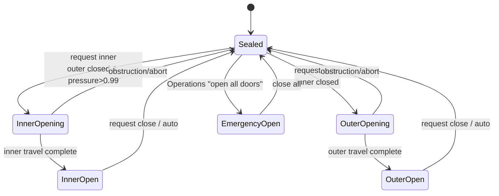
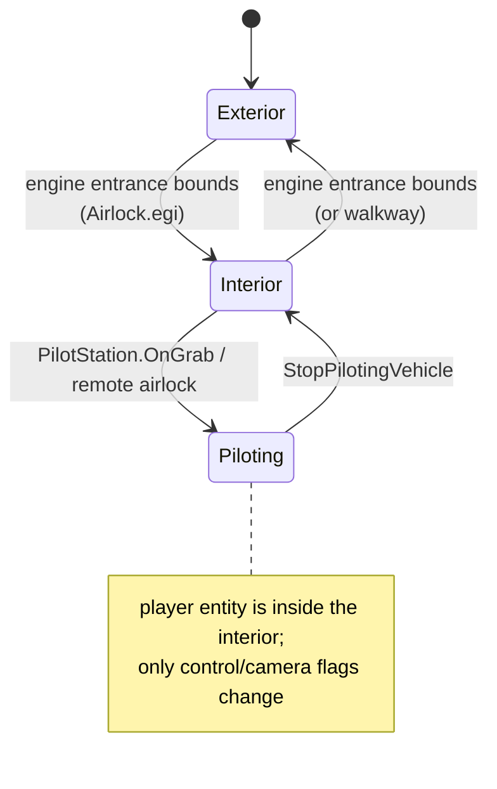

# 03 — Ship Interiors, Rooms, Doors, Seats, and Airlocks

**Scope:** how Rodina 1.6.2 represents a walkable ship/building interior, how the player moves between outside / interior / piloting, how doors and airlocks are wired, and which parts are Lua versus engine. Static source only; line numbers refer to the extracted tree.

**Confidence tags:** `[C]` confirmed in source, `[I]` inferred from call sites/engine API shape, `[U]` engine-side or unresolved.

---

## 1. One-paragraph summary

A vehicle owns an **interior entity** (`Engineering type "Interior"`) whose map is an `.egi` file (`InteriorPath`) plus an optional grammar generator. The interior contains **rooms**, each with an engine-maintained air pressure; **doors** are placeable `Items.Door`/`Items.DoorAirlock` child entities addressed by name (`DoorAirlockIn`, `DoorAirlockOut`); a single **Airlock Computer** item owns three state flags (`CloseAirlock`, `OpenAirlockIn`, `OpenAirlockOut`) that the airlock menu writes. The Lua interlock routine that would enforce pressure and door sequencing exists but is **commented out in 1.6.2**; the engine's `RoomPressure` component and native airlock behaviour are the actual runtime authority `[I]`. The player is a normal character entity parented into the interior, so walking inside a moving ship is just local-space character physics. Entering and leaving is handled by engine entrance bounds derived from the entrance `.egi`; the ship's boarding walkway is a separately spawned/removed item with a special animated physics motion type.

---

## 2. Entity and coordinate model

```
EGVehicle (ship)
 ├── exterior model / mesh physics
 ├── Interior entity                  ← engine-created from InteriorPath / InteriorGenerator
 │    ├── Room entities               ← EGRoom, engine pressure component
 │    │    └── door / furniture / machine items
 │    ├── DoorAirlockIn / DoorAirlockOut
 │    ├── Airlock Computer (Items.Airlock)
 │    ├── Pilot Station (Items.PilotStation)
 │    └── Player (EGPlayer)           ← parented to the interior
 └── ShipWalkway (spawned only when parked)
```

Evidence:

- `EGVehicle:GetPlayerOrientation` falls back to `self.Engine:GetDefaultPlayerOrientation()` (`EGVehicle.lua:1798-1805`).
- `EGGame:CreatePlayer` fetches `playerVehicle.Engine:GetInterior()`, sets the new player's orientation from `playerVehicle:GetPlayerOrientation()`, and calls `shipInterior.Engine:AddEntityChild(player)` (`EGGame.lua:333-342`).
- `EGVehicle:SetLocalPlayerOrientation` stores `interior.Engine:GetTransformTo(aPlayer.Engine)` (`:1790-1795`), so the saved player position is interior-local.
- `EGShipPlayer:UpdateWalkway` asks for `self.Engine:GetInteriorRootTransform()` and uses it as the walkway's orientation (`EGDataShipPlayer.lua:470-474`), confirming an explicit interior root transform.
- The exact parent/child relation of the interior entity to the vehicle is not created in Lua; the engine owns it `[I]`.

Because the player is a child of the interior (itself fixed to the ship), "walking inside a moving ship" requires no special-case code in Lua: the player's local transform is inherited from the ship frame. The engine character physics still reports a movement context (`GROUND`/`IN AIR`) and applies local gravity (`EGCharacterActor.CharacterPhysics`, `:21-51`; `GetCharacterPhysicsContext` use at `EGDataItems.lua:1348`).

---

## 3. The `.egi` interior formats

Three families are visible. This matters for any attempt to read or convert interiors.

### 3.1 Version 1 — ASCII grid ("EGG" text)

Example: `Data/Models/map1.egi`, `map2.egi`, `Data/Interiors/EmptyMap.egi`, `Old Default Map.egi`. Structure:

```
EGG
1
INTERIOR
<grid width>
<ASCII rows using . o * / \ P 9 8 ...>
TILESETS
...
DECORATIONS
...
DOORS
...
ENTITIES
...
```

The ASCII rows are the room/cell layout (`.` open, `o` floor/wall, `*`/glyphs for props and markers). `EmptyMap.egi` has a 42-wide circular room layout and a large decoration/light table (1,842 null-string slots, 49 `LIGHT_1` markers, 124 `NONE` entries). This is a legacy editor format, readable but not the current one.

### 3.2 Versions 14–17 — structured ASCII

Examples and counts:

| File | Version | Rooms | Door records | Entities |
|---|---|---|---|---|
| `Data/Interiors/Airlock.egi` | 14 | 1 (`Bridge`) | 2 (`DoorAirlockIn/Out`) | 2 (Airlock, CeilingLight2) |
| `Data/Interiors/OutpostEntrance2x3.egi` | 14 | 3 | 0 | 2 |
| `Data/Interiors/OutpostEntrance.egi` | 15 | 4 | 0 | 2 |
| `Data/Interiors/OutpostEntranceIce.egi` | 15 | 4 | 0 | 2 |
| `Data/Interiors/XenoBuildingEntrance.egi` | 17 | 2 | 1 | 2 |

Header fields observed after `EGG`/version/`START OBJECT`/`INTERIOR`: grid width, height, depth; then six numbers that appear to encode origin and cell dimensions; then `ROOMS`.

Per room:

```
BEGIN ROOM
<room id>
<room name, e.g. "Bridge" or "Xeno Mine">
<bool> <bool>                      -- likely generated/entrance flags (not verified)
BEGIN ROOM COORDS
<count>
<x> <y> <z> <height> <wall?> <tileset?> <a> <b>
...
BEGIN ROOM WALLS OUTLINE
<count> ...
BEGIN ROOM WALLS INTERIOR
<count> ...
BEGIN ROOM DOORS
<count> ...
BEGIN OPEN CONNECTIONS
<count> <neighbour room ids...>
```

Then `GENERATOR`, `DOORS`, `CUSTOM LIGHTS`, `ENTITIES`, `TILESETS`.

Door records in `Airlock.egi`:

```
DOORS
2
24803
0
0
DoorAirlockIn
13 11 2 2 false
24804
0
0
DoorAirlockOut
13 9 2 2 false
```

i.e. `id, localId, ?, name, x, z, ?, ?, bool`. The two names are exactly the names the airlock scripts look up (`GetChildEntity("DoorAirlockIn")`). Entity records are `name, id, x, y, z, rotX, rotY, rotZ, bool`.

**Do not overclaim these field meanings.** The names and coordinates are confirmed; several integer fields are not documented and the writer (`System.Interior.SaveMap`) is engine-side.

### 3.3 The player ship map — binary `.egi`

`Data/Interiors/DefaultMap.egi` (76,009 bytes) is **not ASCII**. It starts with a little-endian string table:

```
7b 05 00 00 5c 00 00 00 "FTL_Radio" 59 00 00 00 "GunRepeatingBlasterMounted" ...
```

Strings include `GridWidth`, `GridHeight`, `GridDepth`, `GridCellWidth`, `GridCellHeight`, `OriginCoord`, `BeginX/Y/Z`, `EndX/Y/Z`, `RoomInteriorWalls`, `DefaultTileset`, `Seed`, `Generated`, room names (`Bridge`, `Living Area`, `Bathroom`, `Medical`, `Corridor`, `Engineering`), item names (`PilotStation`, `PilotChair`, `Airlock`, `DoorAirlockIn/Out`, `LimnalDrive`, `Scanners`, `ShipStatus`, `FTL_Radio`), and decoration names. It is a binary serialization of the same conceptual map, written by the in-game ship-layout editor.

The file can be inspected as strings and partly interpreted, but **no complete schema is exposed**; do not claim to parse it. The legacy `Old Default Map.egi` (v5 ASCII) is the Vanguard chunk's interior (`EGDataShipVanguardChunk.lua:9`), while the player ship uses this binary file (`EGDataShipPlayer.lua:8`).

### 3.4 Why three formats

`System.Interior.SaveMap` / `LoadMap` are engine calls (`EGSceneEditor.lua:1003-1010`), and the `.egi` version number tracks an engine writer that changed over a decade. Shipped content preserves old maps. This is a good argument for Starfall to use **one versioned text resource** for interiors from day one and to never let the editor write a different format than the runtime reads.

---

## 4. Rooms, walls, connections, tilesets

### 4.1 Room semantics

- `EGRoom` is an `EGWorldObject` with `EntityType = "Room"` (`EGRoom.lua:3-6`).
- It exposes `GetAirPressure()` and `GetAirDecompressionForce(entity)` directly from the engine (`:28-35`).
- It has no serialization of its own (`Load` is empty, `:16-21`); room state is reconstructed by the engine from the interior map.
- `EGInterior.Components = { "InteriorFire", "RoomPressure" }` (`EGInterior.lua:7`) is explicit evidence that fire and pressure are **engine components**, not Lua simulations.

Rooms in the grammar/data carry role flags (`IsMedical`, `IsEngineering`, `IsStorageRoom`, `IsArena`, …) and properties (`Radius`, `Shape`, `Height`, `Tileset`, `Fog`, growth/symmetry), but those are generation-time attributes, not runtime room state (see `05_PROCEDURAL_CONTENT.md`).

### 4.2 Doors

`Items.Door` (`EGDataItems.lua:542-600`) is the base:

- `IsDoor = true`, `EntityType = "Door"`.
- `OpenForActor` only opens within `ActorOpenLimit = 5 m`.
- `Autoclose = true`, `ActorAutoCloseDist = 6 m`.
- Animation moves named model parts `Left`, `MidLeft`, `MidRight`, `Right` (`:594-600`) — direct evidence that model sub-parts are animated by name, not by skeletal animation.
- `Open()`/`Close()` call engine `OpenDoor`/`CloseDoor`; `GetOpenFactor()` exposes a 0..1 animation value.

`Items.DoorAirlock` adds `DoorSize = 2`, slower opening (`OpenSpeed 1.5`), `OpenMult 2.8`, and a single sliding part `DoorAirlock`. `DoorAirlockIn`/`Out` set `Autoclose = false`, `IsAirlockDoor = true`, and their `OnGrab` just writes the airlock computer flags. `DoorAirlockOut:Open` additionally calls `vehicleOwner:OnOpenAirlock()` first (`:673-681`), which produces the "ship is actively moving / relativistic" warning (`EGVehicle.lua:2183-2201`).

### 4.3 Tilesets

`DataGameplay/EGDataTilesets.lua` registers 14 tilesets with `System.Interior.RegisterTileset`:

| Name | Grid | Model prefix | Notes |
|---|---|---|---|
| `Bridge` | 2×3 | `TilesetBridge` | |
| `Bathroom` | 2×3 | `TilesetBathroom` | |
| `Living Area` | 2×3 | `TilesetLivingArea` | |
| `Engineering` | 2×3 | `TilesetEngineering` | |
| `Corridor` | 2×3 | `TilesetCorridor` | |
| `Medical` | 2×3 | `TilesetMedical` | |
| `Installation` | 2×3 | `TilesetInstallation` | |
| `Hanger` | 2×3 | `TilesetHanger` | display spelled "Hangar" |
| `Holoscreen` | 2×3 | `TilesetHoloscreen` | wall/ceiling only |
| `Holoscreen (Full)` | 2×3 | `TilesetHoloscreenFull` | wall/ceiling/floor |
| `Xeno Mine` | 3×3 | `TilesetXenoMine` | |
| `Xeno Ice Mine` | 3×3 | `TilesetXenoMine` | palette tint + backside colour |
| `Xeno Building` | 3×3 | `TilesetXenoBuilding` | `DecorationResolution = 3` |

Each cell is a 2×3 or 3×3 model grid; the prefix names the family of `Tileset<Name>.*.egm` models. A cell has floor/ceiling/wall/corner variants (`Wall`, `FloorNE`, `Cap225.Bottom`, `DoorFrame`, etc. — visible in `Data/Models/Tileset*.egm`). The `GridWidth`/`GridHeight` are model-grid dimensions, not world metres; no Lua constant states the cell size. Starfall's 4 m cabin grid is a reasonable independent choice but cannot be claimed to match Rodina.

### 4.4 What the layout editor proves

`EGMenuShipLayout` paints rooms, smears tiles, deletes tiles, places entities, edits lights, saves/loads maps, and has separate room/wall/entity modes (`EGMenuShipLayout.lua:86-190`, `:372-435`, `:1142-1174`). It is an **in-game editor**, not a runtime generator. The existence of a first-class map editor explains why `.egi` is the durable content format and why grammar-generated interiors had to coexist with hand-authored entrance maps.

`EGSceneEditor:OnSaveInterior` delegates to `System.Interior.SaveMap`; `OnLoadInterior` to `LoadMap` (`EGSceneEditor.lua:1003-1010`). The map object type `EGInteriorMap` is engine-side; it exposes `GetRoomIDAtPos`, `IsRoomIDEntrance`, `SetCurrentRoom`, etc. (`:571-601`, `:936-946`).

---

## 5. Seats, pilot stations, and sitting

There are **two different concepts** that are easy to conflate:

### 5.1 Chairs (engine sitting)

`Items.DeskChair`, `Items.PilotChair`, and `Items.Toilet` are furniture with `IsChair = true` and `ChairBackwards = true` (`EGDataItems.lua:64-71`, `:102-110`, `:201-207`). `EGGravBike` is also `IsChair = true` with `ChairTypeSidesOnly = true` (`EGGravBike.lua:8-9`). The engine API is visible only through use:

- `actor.Engine:GetCurrentChair()` — which chair an actor occupies.
- `actor.Engine:ForceSitInChair(chair.Engine)` — force a sit.
- On the bike, `OnGrab` sits the actor only if `aActor.Engine:GetIsInSpace()` and then sets `Running` (`EGGravBike.lua:78-99`).

There is **no Lua implementation of sitting**, no sit animation call, and no Lua seat state machine. The `PilotChair` is *not* referenced by piloting code at all. It is furniture that the engine can seat a character in; piloting is triggered by the `PilotStation` console.

### 5.2 Pilot station (control transfer)

`Items.PilotStation:OnGrab` is the real "take the helm" interaction (`EGDataItems.lua:495-513`). It is a `ShowInfo` machine with model `Machines.PilotStation.egm`. It:

- Refuses if ship health ≤ 0.
- Refuses if `interior:GetAllDoorsOpen()` (emergency all-doors-open state).
- Enables first-person piloting.
- Calls `gGame:StartPilotingVehicle(vehicleOwner)`.
- Autosaves "Pilots Ship".

It does **not** call `ForceSitInChair`, does not move the player, and does not play a sit animation. In 1.6.2, "piloting" is a control/camera mode entered at a console, not a seated state. Whether the engine visually seats the camera at the station is engine-side `[U]`.

### 5.3 Minimum seat model Starfall should use

Starfall already has a `seat_position` and an F-to-sit interaction (`scripts/pilot.gd:81-109`). Rodina's evidence supports keeping the seat and the station as separate data but binding them explicitly:

- A `Seat` resource has a ship-local transform, facing, occupant, and allowed roles.
- A `Station` (console) has an interaction transform and a reference to a `Seat` and a control interface.
- Sitting is a physical/visual state; piloting is an authority state. A player can sit without piloting (passenger/crew), and a station can be used without sitting (remote console).

That separation is more robust than Rodina's implicit console-only model and is directly useful for crew roles.

---

## 6. The airlock

### 6.1 Confirmed pieces

| Piece | Evidence |
|---|---|
| `Items.Airlock` is the "Airlock Computer", model `Machines.Airlock.egm` | `EGDataItems.lua:332-339` |
| Three public flags: `CloseAirlock=false`, `OpenAirlockIn=false`, `OpenAirlockOut=true` | `:346-348` |
| `AirPressure=0`, `AirPressureTime=3` fields | `:349-350` |
| `OnGrab` opens `EGMenuAirlock` with `{Vehicle, Computer}` | `:341-344` |
| Inner/outer door entities are found by name `DoorAirlockIn` / `DoorAirlockOut` | `:358-359`, `:650`, `:667` |
| Menu writes the three flags; `CLOSE` sets `CloseAirlock=true`; `OPEN IN` sets `OpenAirlockIn=true, OpenAirlockOut=false`; `OPEN OUT` sets the reverse | `EGMenuAirlock.lua:167-190` |
| Menu displays `Computer.AirPressure` as a bar/percentage | `:56-93` |
| Menu has "Modify Ship Layout" (blocked in combat) and "Remotely Pilot Ship" | `:122-140`, `:191-206` |
| Remote pilot sets `AllowFirstPersonPilot=false` | `:228-231` |
| Engine exposes `interior.Engine:SetExteriorDoorsClosed(bool)` and `GetExteriorDoorsClosed()` | `EGDataItems.lua:366`, `EGDataShipPlayer.lua:465` |

### 6.2 The interlock code is disabled

The entire body of `Items.Airlock:Update` is inside a Lua long comment:

```lua
function Items.Airlock:Update( aDeltaTime )
---[[
    ... inDoor/outDoor lookup ...
    interior.Engine:SetExteriorDoorsClosed(outDoorClosed)
    self.AirPressure = room:GetAirPressure()
    if vehicleOwner and vehicleOwner:IsPiloted() then
        self.OpenAirlockOut = false; outDoor:Close()
    end
    if self.CloseAirlock then inDoor:Close(); outDoor:Close()
    elseif self.OpenAirlockIn then
        outDoor:Close()
        if outDoor:GetOpenFactor()==0 and self.AirPressure > .99 then inDoor:Open() end
    elseif self.OpenAirlockOut then
        inDoor:Close()
        if inDoor:GetOpenFactor()==0 then outDoor:Open() end
    end
--]]
end
```

(`EGDataItems.lua:353-403`; opening delimiter at 354, closing at 401.)

The intended rules are clear and are worth recording:

1. **Inner opens only if the outer is fully closed and pressure > 0.99.**
2. **Outer opens only if the inner is fully closed.**
3. **Closing closes both.**
4. **Piloting forces the outer door closed.**
5. The exterior-door-closed flag is published to the interior every update.

But in 1.6.2 **no readable Lua enforces them**. Therefore either the engine implements the same rules natively, or the airlock menu flags are decorative and doors are only animated by direct activation. Given that `RoomPressure` is an engine component and `SetExteriorDoorsClosed` exists on the engine, the engine-side implementation is the most plausible `[I]`. This is a genuine gap in the readable source, not a design choice we can confirm.

The `AirPressure` field read by the menu is likewise only assigned in the disabled Lua block. It may be written by the engine `[U]`. Do not infer the pressure truth from the menu’s displayed value in a reimplementation.

### 6.3 Pressure model that can be confirmed

- `EGRoom:GetAirPressure()` → `Engine:GetRoomAirPressure()` (`EGRoom.lua:28-30`).
- `EGRoom:GetAirDecompressionForce(entity)` → `Engine:GetAirDecompressionForce(entity.Engine)` (`:33-35`).
- `EGRoomXenoOutpost` overrides both: pressure always `1`, force always zero (`EGInterior.lua:226-232`). Xeno outposts are always pressurised/non-simulated.
- `EGInterior` exposes one global `AllDoorsOpen` flag, saved and engine-read (`EGInterior.lua:35,48,59,85-87,174-180`). The Operations computer toggles it with "EMERGENCY OPEN ALL DOORS" (`EGMenuOperations.lua:240-257`, `:384-386`).
- The character applies decompression force only when `interior:GetAllDoorsOpen()` is true; if the character is "IN AIR" and not using a jetpack, the force is scaled by `0.01` (`EGCharacterActor.lua:350-379`).
- `AIR_DEPRESSURIZE_RATE = 10` and `AIR_PRESSURIZE_RATE = 0.33` are declared in `EGRoom.lua:8-9` but **never used**. They are dead constants, not the rates.
- Planet atmospheric pressure is a separate function: `EGPlanet:GetAirPressure(target)` maps altitude factor to `0…1`, forced to 0 if `AtmosphereDensity == 0` (`EGPlanet.lua:140-147`). The character uses room pressure when in a room, otherwise planet pressure, for jetpack refill (`EGCharacterActor.lua:422-439`).

**Conclusion:** room pressure is an engine scalar per room with some equalisation/leak behaviour, plus a per-room decompression force. The exact rate, equalisation graph, and vacuum damage are not visible in Lua. There is no Lua vacuum-damage rule at all; only push force.

### 6.4 A defensible airlock state machine

For Starfall, implement the rules the disabled code describes, but add explicit states and sensors. This is the state machine the evidence supports:



Non-negotiable invariants (from evidence + safety reasoning):

- Never both doors open.
- Opening the outer door requires the inner to be fully closed (`openFactor == 0`), not merely "closing".
- Opening the inner door requires the outer fully closed **and** pressure at equilibrium.
- Takeoff / piloting forces the outer door closed.
- A character standing in the doorway blocks closing (Rodina checks only factors, not occupancy — this is an improvement, not a copy).
- Decompression force applies only when a pressurized volume is open to vacuum; Rodina's global `AllDoorsOpen` switch is a coarse approximation and should be replaced by per-room pressure.

---

## 7. Boarding, the walkway, and transitions

### 7.1 Entrance bounds

`System.Interior.MakeEntranceBounds` is called for `Airlock.egi`, `OutpostEntrance.egi`, `OutpostEntranceIce.egi`, and `XenoBuildingEntrance.egi` (`EGDataItems.lua:2076-2079`). `System.Interior.MakeBounds("XenoBuildings.Mine.egm", 3,3, low, high)` defines a coarse building volume. These are engine-side trigger volumes derived from the entrance map. No Lua code detects "player near airlock" or teleports them; the engine does `[I]`.

The ship's `EntrancePath = "Airlock.egi"` (`EGDataShipPlayer.lua:9`) is the map used to build those bounds. This is why the entrance is a separate small `.egi` rather than the ship's full interior: it is both a spawn transform and the boarding volume.

### 7.2 Walkway

`Items.ShipWalkway`:

- Model `Ship1.ShipWalkway.egm`.
- Physics `ShapeType = "Box"`, `MotionType = "EG_MOTION_ANIMATED_WALKWAY"`, extent `(-2,-32.4,-0.2)…(2,0,0)` (`EGDataItems.lua:1148-1157`).

`EGShipPlayer:UpdateWalkway` (`EGDataShipPlayer.lua:452-485`):

- Reads current walkway by child name `"ShipWalkway"`.
- Reads `speedSqr = localVelocity:LengthSqr()`.
- Reads `doorsClosed = interior.Engine:GetExteriorDoorsClosed()`.
- `playerCameraInside = doorsClosed and IsPlayerAndCameraInsideVehicle()`.
- **Spawn** when: no walkway, ship not player-controlled, not dead, `speedSqr < 75` (≈8.66 m/s), and not `playerCameraInside`.
- Spawn transform: `interiorRootOrientation` with `ExtraRotation(0, +30°, 0)`.
- **Remove** when: player-controlled, dead, `speedSqr > 500` (≈22.36 m/s), or player camera inside.

This is a **double-threshold hysteresis** (75 spawn / 500 remove). It is a useful pattern: deploy only when slow and unpiloted; retract well before the ship reaches a speed where the ramp would be dangerous. The engine's `EG_MOTION_ANIMATED_WALKWAY` presumably angles the geometry to the ground; Lua does not compute terrain contact for it. That is a key difference from Starfall, which already fits the ramp to sampled terrain (`ship_cabin.gd:165-177`) — Starfall's approach is better documented and independently implemented.

### 7.3 Player transitions

Rodina's Lua has no explicit `EXTERIOR → INTERIOR` transition function. The observable model is:



Evidence:

- `StartPilotingVehicle` does not move the player; it only reuses/creates the interior child and flips control flags (`EGGame.lua:237-262`).
- `StopPilotingVehicle` restores player control and physics, again without moving the player (`:294-312`).
- Boarding is engine-side, via `MakeEntranceBounds` and `EntrancePath` `[I]`.
- The walkway is spawned/despawned by speed and pilot state, independent of a boarding transition (`EGDataShipPlayer.lua:452-485`).

**What happens if the ship takes off with someone inside?** They are parented to the interior, so they move with the ship `[C for parenting; I for transform inheritance]`. Their character physics continues in the ship frame.

**What happens if the ship takes off with someone outside?** There is no Lua safeguard. The ship's `SetPiloted(true)` detaches the walkway (speed/pilot condition), and the outside character remains in the planet frame while the ship flies away. `OnOpenAirlock` only issues a HUD warning if the ship is moving or at relativistic speed (`EGVehicle.lua:2183-2201`). Multi-crew safety is not implemented — single-player makes this tolerable. **Starfall must add explicit occupancy/authority checks** (see `08`).

---

## 8. Fire and other interior state

- Fire is an engine component (`Components = {InteriorFire, RoomPressure}`, `EGInterior.lua:7`).
- `EGInterior:StartFire/StopFire/GetFireSurrounding` are engine calls (`:146-171`).
- Ship damage can start a fire: `EGVehicle:DamageHealth` computes a probability from damage percentage, a long-interval high chance, and a fire-chance modifier; if it fires, it converts the impact into interior-local coordinates and calls `interior:StartFire(position)` (`EGVehicle.lua:2069-2132`). Fires only after the `ShowPlanets` story stage.
- `EGInterior:UpdateFireDamage` applies ship damage when `GetOnFireAmount() > 20`, scaled `.2…1` from amount `40…100` (`EGInterior.lua:105-118`).
- `UpdateFireAlarm` sets a red light override and HUD "FIRE"; death sets a dim override (`:121-143`).
- Character fire damage applies when `GetFireSurrounding(self) > 0.25`, up to `30 HP/s` at strength 1 (`EGCharacterActor.lua:443-469`).
- The fire grid itself (`EGGrid`, per-cell strength/extinguish timer) is commented out in `Encode/Decode/Load`; fire state is **not saved** (`EGInterior.lua:41-89`). On load, fire is gone.

This is a good model to learn from for hazard propagation, but not to copy: saving fire state is worth doing in Starfall, and a per-room pressure/fire grid is a natural fit for a `Resource`-driven interior.

---

## 9. The smallest reliable walkable-interior model for Starfall

Rodina's readable source supports this minimal independent concept set. It is deliberately smaller than Rodina's engine feature set.

| Concept | Responsibility | Suggested Godot shape |
|---|---|---|
| `ShipInterior` | Owns rooms/portals/seats, ship-local space, bounds | `Node3D` + `InteriorLayout` resource |
| `Room` | Convex walkable volume(s), pressure, hazard state, ambience | `Area3D`/`Node3D` + `RoomState` resource |
| `Portal` | A doorway between two rooms or room↔outside; open factor, lock, occupancy | `Node3D` + `Portal` script |
| `Airlock` | Two portals + a small volume + pressure + interlock state machine | `Node3D` + `AirlockController` |
| `Seat` | Ship-local sit transform, facing, occupant, role | `Marker3D` + `Seat` script |
| `Station` | Interactable console that grants control or opens UI; links to seat/role | `Area3D` + `Interaction` component |
| `Occupancy` | Who is in which room/portal/seat, continuously updated | `InteriorOccupancy` autoload/node |
| `BoardingTrigger` | Outside↔inside transition volume, authority check | `Area3D` + `BoardingController` |
| `Walkway` | Deployable ramp, terrain fit, occupancy, retract rules | `Node3D` + animation + `ShipCabin`-style queries |
| `PlayerMode` | `EXTERIOR / INTERIOR / SEATED / PILOTING / DEAD`; who owns input/camera | State machine on the player |

**Rules that make it reliable:**

1. One authority state machine for the player; no scattered booleans.
2. One occupancy registry; every transition checks it.
3. Doors and airlocks are graph edges, not free-floating props.
4. Pressure is per-room and conserved; never store it only in UI.
5. The walkway is a physical deployable with an occupancy sensor and a ship-speed interlock.
6. Boarding is a transition request validated by the controller, not a trigger that teleports blindly.

Starfall already has a strong base for this: kinematic walkability rectangles, room/door state, an airlock interlock, terrain-fitted ramp, and a player mode enum (`scripts/ship_cabin.gd`, `scripts/pilot.gd`). The upgrade path is to replace rectangles with a small room/portal graph and add occupancy/pressure, not to rewrite the cabin.

---

## 10. Evidence summary

| Claim | Evidence | Confidence |
|---|---|---|
| Interior is a vehicle-owned entity with engine map | `EGVehicle.lua:1791-1805`; `EGGame.lua:333-342` | C for APIs, I for parenting |
| Player is parented to the interior | `EGGame.lua:335-341` | C |
| Player position saved interior-local | `EGVehicle.lua:237,277-282,1790-1795` | C |
| `.egi` v1 is ASCII grid; v14–17 are structured ASCII; player map is binary | `Data/Interiors/*`; `file`/header inspection | C |
| Tilesets are 2×3 or 3×3 model grids | `EGDataTilesets.lua:3-164` | C |
| Door animation is by named model parts | `EGDataItems.lua:594-600`, `:633-636` | C |
| Airlock flags and menu writes | `EGDataItems.lua:346-348`; `EGMenuAirlock.lua:167-190` | C |
| Lua interlock body is commented out | `EGDataItems.lua:353-403` (delimiters 354/401) | C |
| Intended interlock rules | same block | C (as intent, not runtime) |
| Room pressure/fire are engine components | `EGInterior.lua:7`; `EGRoom.lua:28-35` | C |
| Pressure rates `10`/`.33` are dead code | `EGRoom.lua:8-9`, no references | C |
| Decompression only when `AllDoorsOpen` | `EGCharacterActor.lua:375-377` | C |
| Walkway hysteresis 75/500 speed² | `EGDataShipPlayer.lua:468,478` | C |
| Walkway spawns when slow/unpiloted and removes when piloted/fast/inside | same | C |
| Engine entrance bounds drive boarding | `EGDataItems.lua:2076-2079`; `EGDataShipPlayer.lua:9` | C for calls, I for trigger behaviour |
| No Lua seating implementation | `EGGravBike.lua:78-99`; no seat calls in pilot flow | C (absence) |
| Piloting is console-triggered, not seat-triggered | `EGDataItems.lua:495-513` | C |
| Takeoff with player outside is not guarded | no code path; only HUD warnings at `EGVehicle.lua:2183-2201` | C (absence) / I (consequence) |
| Fire state is not saved | `EGInterior.lua:41-89` | C |

---

## 11. Cross-references

- Flight/pilot mode and cameras: `02_SPACESHIP_AND_PILOTING.md`
- Interior generation grammars and room roles: `05_PROCEDURAL_CONTENT.md`
- Data formats and `.egi` limitations: `07_DATA_FORMATS_AND_ASSETS.md`
- Starfall implementation sequence: `08_STARFALL_IMPLEMENTATION_GUIDE.md`
- Save-state asymmetry for interior/fire: `10_OPEN_QUESTIONS.md`
