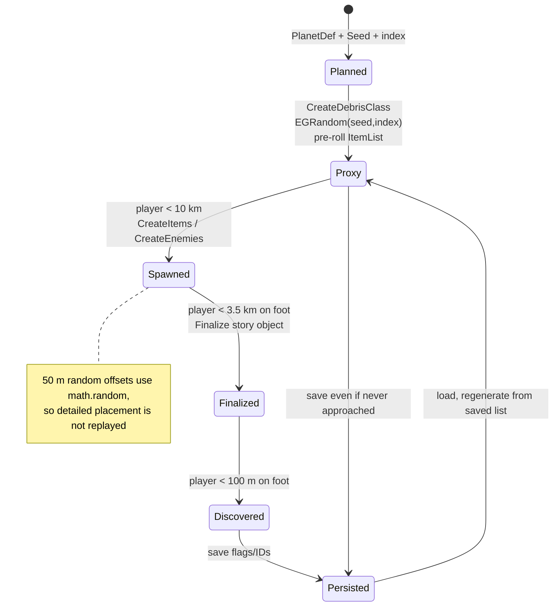

# 05 — Procedural Content, Seeds, Proxies, Discovery, and Persistence

**Scope:** how Rodina 1.6.2 decides what exists on a planet, when it becomes real, how it is discovered and saved, and how its interior grammars work. Static source only.

**Confidence tags:** `[C]` confirmed in source, `[I]` inferred, `[U]` engine-side/unresolved.

---

## 1. One-paragraph summary

Rodina has **two unrelated procedural systems**. Planet-scale content is a seeded **proxy** system: each planet creates a fixed number of `EGProxyItem` markers at deterministic spherical positions; each marker holds a pre-rolled list of item class names; detailed objects are instantiated only within 10 km, a story/primary object within 3.5 km, and "discovered" only within 100 m on foot. Interiors of mines, outposts and derelict capital ships are generated by a separate declarative **EGSL production grammar** (`.rsl`) that expands a room graph, assigns tilesets/lights/fog/doors, then places decorations by weighted parent-slot rules. The PRNG itself is engine-provided (`EGRandom`), so the *policy* is fully readable but the exact number sequence is not reproducible without the engine. Persistence is similarly split: planet-level counts and proxy flags are serialized; detailed entities are saved by engine persistence profiles; interior fire is not saved.

---

## 2. Two systems, not one

| Layer | What is generated | Where the rules live | Deterministic? |
|---|---|---|---|
| Planet surface POIs | proxy marker position, item list, enemy list, story object | `EGPlanet.lua`, `EGProxyItem.lua`, `EGDataGenerate*.lua`, `EGDataProgress.lua` | location/list yes; detailed offsets no (`math.random`) |
| Interiors | room graph, room shapes, tilesets, lights, fog, doors, decorations, enemies | `*.rsl` + `EGDataInteriorGen.lua` + `EGDataDecorationGen.lua` | seed-driven; PRNG engine-side |
| Asteroid belt | orbit, radius, shape, palette, capacity per asteroid | `EGDataPlanets.lua` `Randomize` | yes, from seed+bucket |
| Ship groups | which ship classes spawn in a group | `EGDataGenerateShips.lua` (`EGMakeGenerator`) | yes, from an `EGRandom` stream |

The important negative finding: **the `.rsl` grammar is not used to place planet-scale POIs.** It generates interiors only. Planet-scale variety is a much simpler weighted-list/proxy system.

---

## 3. Seeding model

### 3.1 Sources of seed

| Seed | Source | Persistence |
|---|---|---|
| Planet `Seed` | authored in `PlanetDef` (e.g. Perun `456443`, Veles `65454`) | static data |
| Asteroid `Seed` | `EGRandom(978980, bucket):GetChildSeed(index)` | saved as `AsteroidSeed` (`EGDataPlanets.lua:1175,1418`) |
| Debris index | `DebrisCount + 1` per planet | saved (`DebrisCount`, `DebrisIDs`) |
| Enemy index | `EnemyCount + 1` per planet | saved (`EnemyCount`, `EnemyIDs`) |
| Building `InteriorGenSeed` | `math.random(343434, 9898838)` | saved (`EGBuilding.lua:28,109,120`) |
| Vanguard `InteriorGenSeed` | `math.random(343434, 9898838)` | saved via `EGVehicle:Encode` (`EGDataShipVanguardChunk.lua:52`) |
| World/start scene | `EGRandom(3892342)` for Vanguard placement; `os.time()` seeded `math.random` at startup | not saved |

`math.randomseed(os.time())` runs once at game start (`GameplayMain.lua:9-13`) for non-deterministic cosmetic/random choices. Seeded generation uses `EGRandom`, not `math.random`.

### 3.2 `EGRandom` is engine-provided

`EGRandom` is called 29 times in Lua but never defined there. The confirmed API from usage:

- `EGRandom(seed)` → stream.
- `EGRandom(seedA, seedB)` → a salted stream; used as `EGRandom(planet.Seed, debrisIndex)`.
- `stream:NextFloat()`, `NextFloat(min,max)`.
- `stream:NextInt(min,max)`.
- `stream:NextBool(probability)`.
- `stream:GetChildSeed(index)` — derive a child seed for hierarchical generation (`EGAsteroidBelt.lua:18-30`).
- `stream:NextFloat()` is used with one argument in some places, so overloads exist.

`GetChildSeed` is the strongest architectural clue: Rodina uses a **tree of streams**, not one global sequence. A parent stream owns a bucket, each child owns an asteroid. Starfall should copy this concept with its own stable PRNG.

**The exact algorithm and sequence are not exposed `[U]`.** Do not claim to reproduce Rodina layouts. For Starfall, determinism must be defined by Starfall's own generator, not by matching Rodina.

### 3.3 Why seeds are saved

- `EGBuilding.InteriorGenSeed` is random at creation but persisted (`EGBuilding.lua:28`, `:109`, `:120`). Loading a building regenerates the same interior.
- `EGVehicle.InteriorGenSeed` is persisted at save version ≥26 (`EGVehicle.lua:236`, `:276`, `:375-378`).
- Asteroid `Seed`/`Bucket` are saved (`EGDataPlanets.lua:1175-1180`, `:1418-1423`).
- Planet `Seed` is authored, not saved.

This is the correct pattern: **save the seed, regenerate the content, save only deltas/state**.

---

## 4. Planet-scale POIs: the proxy lifecycle

### 4.1 Planet activation

`EGPlanet:Update` (`EGPlanet.lua:50-96`):

- Finds the player (character or vehicle).
- If the planet is the player's current planet and `distance < Radius * ActiveDistanceOn` (`ActiveDistanceOn = 10`), marks `HasBeenVisited = true`, calls `MakeItems()`, and (if enabled) `MakeEnemy()`.
- Outside that distance, entities are not created; `KillLegacyEntities` can clear old counts/IDs.

`ActiveDistanceOn = 10` is a *radius multiplier*, not 10 km. For a 10,000 km planet, that is 100,000 km — effectively "the planet's local space." `ActiveDistanceOff = 10` exists but is not used in this function.

### 4.2 Debris capacity

`EGPlanet.DebrisCapacity = 15` by default (`EGPlanet.lua:19`), overridden per planet (Perun 15, Zosia 25, Veles 15, etc.). `MakeItems` creates **one debris proxy per update** while `DebrisCount < DebrisCapacity`:

```lua
if self.DebrisCount < self.DebrisCapacity then
    item = self:CreateDebrisClass(nil, self.DebrisCount + 1)
    if item then
        self.Engine:AddEntityChild(item)
        self.DebrisIDs[self.DebrisCount + 1] = item:GetID()
        self.DebrisCount = self.DebrisCount + 1
    end
end
```

(`EGPlanet.lua:256-291`). This spreads entity creation over frames; it is a simple and effective load-shedding pattern.

`MakeEnemy` similarly creates one enemy group per update until `EnemyCapacity`, and stops respawning unless `RespawnEnemies` is enabled (`:294-366`). `EnemyCapacity` default 150, overridden per planet (Perun 60, Veles 75, asteroids 1–3).

### 4.3 Debris proxy placement

`EGPlanet:CreateDebrisClass(prototype, index)` (`:208-248`):

1. Gets `self.DebrisGenerator` (a grammar name, e.g. `PerunDebrisGen`).
2. `random = EGRandom(self.Seed, index)`.
3. Picks a random point in the cube `[-1,1]³`, normalizes it to a unit direction.
4. `EGUnitToGPS(unitDir)` → latitude/longitude; `GetGeoToLocal(gps)` → planet-local position.
5. Generates the item list with `generator:Generate(true, itemList, random)` (true = keep class-name strings).
6. Creates `EGProxyItem` with `Name`, `ItemList`, optional `PrimaryDebrisClassName`, `StoryDebrisStage`, `Position`, `HACKForceScriptUpdate`.

Enemy list generation is commented out in this function (`:227-234`); ground enemies come from `GroundEnemyGenerator`/`GenerateGroundEntityGroup` instead (`:369-417`).

The unit-vector method is simple but not area-uniform (normalizing a uniform cube over-samples corners). Rodina lives with it; Starfall should use an equal-area sphere sampling method (e.g. `z = 1-2u`, `θ=2πv`) for even distribution.

### 4.4 Proxy spawn / finalize / discovery radii

`EGProxyItem:Update` (`EGProxyItem.lua:53-98`):

| Distance to player control actor | Action | Condition |
|---|---|---|
| `< 10,000 m` | `CreateItems()` + `CreateEnemies()`, `HasSpawned = true` (note: `CreateEnemies` is an empty stub in 1.6.2) | once |
| `< 3,500 m` | `Finalize()`, `HasFinalized = true` | once, **only if player is a CharacterActor** |
| `< 100 m` | `HasDiscovered = true` | once, **only if player is a CharacterActor** |

`CreateItems` (`:101-125`):

- Calls `gGame:GetProgress():FilterDebrisList(self, self.ItemList)` to apply story/planet filters.
- For each item class name, resolves `EGGetClass`, makes a random cube offset of ±50 m, converts to `EGPreciseVector`, adds it to the surface position, picks a random rotation (unless `DebrisNoRotate`), and calls `MakeItem`.
- `MakeItem` snaps the position to the surface (`GetSurfacePosition`) and creates `EGDebrisObject` with `{Item = class}`; stores the spawned entity ID.

`Finalize` (`:152-183`):

- If `PrimaryDebrisClassName` is set, uses that class.
- Otherwise asks the progress system for `AddDebris` and expects at most one item; more than one is an error.
- Creates one item at the proxy's base position.

So the proxy is a **cheap marker + pre-rolled list**; the "real" content is a handful of physics debris objects within 50 m, plus a story object if applicable. It is not a dungeon or a building.

### 4.5 Discovery semantics

| Entity | Discovery rule | Stored where |
|---|---|---|
| Planet | arrival within 100,000,000 km in `UpdatePlanetOrbitArrival` and a valid approach vector; or `Discover(planet)` by class name | `EGPlayerInfo.Discovered[ClassName]` |
| Player ship | player is inside its interior | `EGPlayerInfo.Discovered[ClassName]` |
| Vanguard chunk | same interior test | `EGPlayerInfo.Discovered[ClassName]` |
| Generic vehicle | within `DiscoveryDistance` (default 1,000 m; scouts 4,000; battleship 10,000) | `EGPlayerInfo.Discovered[ClassName]` |
| Debris proxy | within 100 m on foot | **proxy's own `HasDiscovered` flag** |
| Asteroid / star | always discovered | implicit |

Evidence: `EGVehicle.lua:680-722` (arrival), `:2268-2280` (vehicle discovery), `EGDataShipPlayer.lua:489-500` (ship interior), `EGDataShipVanguardChunk.lua:138-149`, `EGProxyItem.lua:78-80`, `EGPlayerInfo.lua:128-162` (class-name keyed discovery).

**Important:** `EGPlayerInfo:Discover` stores `aObject.ClassName`, not a unique instance ID. For debris proxies (all `EGProxyItem`), that would collide, which is why the proxy keeps its own boolean. This is a design smell to avoid in Starfall: use a stable per-instance ID for discovery.

### 4.6 Proxy persistence

`EGProxyItem:Encode/Decode` (`:244-271`) saves:

- `HasFinalized`, `HasSpawned`, `HasDiscovered`
- `ItemList` (class-name strings)
- `Spawned` (entity IDs)
- `StoryDebrisStage`, `PrimaryDebrisClassName`, `HACKForceScriptUpdate`
- deprecated `EnemyList`

`Load` (`:274-311`) reads the same with version gates for `HasDiscovered` (≥11), story fields (≥20), and `EnemyList` (≥32).

`PersistenceProfile = "PersistencePlanetwide"` (`EGProxyItem.lua:8`), whose policy is `InstantiateLevel = EG_LOD_CURRENT_PLANET`, `PersistInStorage = true` (`EGData/EGEditorData.lua:700-713`). So proxies are saved per planet and resurrected when the planet is active; detailed debris entities use `PersistencePlanetwide` too (`EGDebrisObject.lua:8`).

### 4.7 Lifecycle diagram



---

## 5. Authored surface structures

Buildings are not generated by a planet-wide grammar. They are listed on the planet:

```lua
Bases =
{
  { Type = "EGBuildings.XenoMine", Name = "XenoMine-Perun-1", Seed=878937, Position="RandomCube" },
  ...
}
```

(`EGDataPlanets.lua:335-350` for Perun; `:447-465` for Veles; `:1153-1165` and `:1392-1400` for asteroids).

`EGBuilding` (`EGBuilding.lua`):

- `InteriorGenerator = "EGXenoOutpostInteriorGen"` (a production name binding).
- `EntrancePath = "OutpostEntrance.egi"`, with a backup `OutpostEntrance2x3.egi`.
- `FlattenTerrainInnerRadius = 15`, `FlattenTerrainOuterRadius = 150`.
- `Components = { "Building", "FlattenTerrain" }`.
- Physics `ShapeType = "Mesh"`, `MotionType = "EG_MOTION_DRIVEN_LOCKED"`.
- `InteriorGenSeed` random at creation, persisted.
- `XenoCount` tracked for the target UI ("Status: N Xenos" / "Cleared").

`EGDataBuildings.lua` has 7 building classes (`XenoMine`, `XenoMineIce`, `XenoBuilding3x3`, `5x5`, `T`, `Cross`, `CrossWide`, `V`) with different models, radii, door types, and entrance maps. Placement is fixed-seed, not rule-generated; only the *position* is randomized by `"RandomCube"` (engine-side).

This is the right scope for Starfall's first POI pass: **authored POI types, seeded placement, procedural interiors only if you need them**. A full grammar like EGSL is a later milestone.

---

## 6. Asteroid belt

`EGAsteroidBelt` (`EGAsteroidBelt.lua`):

- `Radius = 1.5 AU`, thickness `.015 AU`, height ±`.06°`.
- Bucket size `1.0`, frequency `125`, bucket span `2`.
- `MakeAsteroidClass(index, bucket)`:
  - `parentRandom = EGRandom(978980, bucket)`
  - `seed = parentRandom:GetChildSeed(index)`
  - creates an `Asteroid` instance, sets `Seed`, `Bucket`, `PersistenceProfile = "PersistenceAsteroid"`, `RecreateFunc` (for save/restore), and `Randomize()`.
- `MakeBigAsteroidClass(index)` uses `EGRandom(3432803)` and `GetChildSeed(index)`.

`Asteroid:Randomize` (`EGDataPlanets.lua:1295-1342`) derives:

- orbit angle, elevation, orbit radius (concentrated toward torus centre by `r * abs(r)`);
- rotation period, tilt;
- enemy/debris capacity;
- chunkiness and lowest terrain radius;
- `GenerationVars[7,13,14,16,17,100,104,107]`;
- LOD multiplier from radius.

This is a compact, complete example of **deterministic asteroid variety from one seed**. It is the best model in the archive for Starfall's seeded POIs.

---

## 7. Interior grammars (EGSL)

### 7.1 Language

The `.rsl` files are written in **EGSL**, named by the developers in `ProductionTestCore.rsl:15` ("Oh god, EGSL has no recursion :("). Ten files, ~3,625 lines, ~338 productions, 89 `concept` declarations, 49 distinct `let` predicates.

Syntax:

```
production XenoOutpostInterior( interior, entrancePath )
    weight 10
    concept mainChain, boss_room, reward_room
    concept e0, e1
    produce XenoOutpostWingNode2( mainChain, entrancePath, e0 )
    produce Room( boss_room, e0, e1 )
    produce XenoMineDebrisRoom( reward_room, e1 )
    produce DefaultHallwayTileset( interior )
    produce LightTypes( interior )
    let IsInterior( interior )
    let IsXenoMine( interior )
    let IsXenoMine( boss_room )
    let IsArena( boss_room )
    ...
end
```

(`XenoMineProductions.rsl:271-299`).

- **Overloading by name + arity.** `XenoOutpostWingNode` is declared with 2, 3 and 4 parameters (`:127`, `:138`, `:149`); the engine selects by argument count.
- **`weight`** is relative probability among same-signature alternatives. Empty bodies are a valid "spawn nothing" outcome (e.g. turret rules, `XenoBuildingDecorationProductions.rsl:3-15`).
- **`priority`** is used as a specificity ladder (generic room shape priority 1, specific role priority 2, storage/arena 3–5). Its exact interaction with `weight` is **not defined anywhere** `[U]`.
- **`let` is overloaded**: it is both a precondition (`let IsXenoMine(node)`) and an assertion that writes a property (`let Radius(room, 4)`, `let Tileset(room, "Medical")`). No syntax distinguishes them `[U]`. This is the single biggest obstacle to reimplementing EGSL faithfully.
- **`concept`** declares untyped IDs. Convention, not syntax, distinguishes nodes from edges: an edge is a concept passed in an edge position to a `produce`.
- **No recursion.** `IsAncestor` is manually unrolled to depth 6 (`ProductionTestCore.rsl:15-87`).
- `rule` declarations are derived predicates with variables (`:1-193`); `property` declares room properties (`:201-222`).
- `variable p` binds an intermediate concept in a rule.

The engine interprets the files; **no Lua loader exists**. The only bridge is `ProductionName` (e.g. `EGXenoOutpostInteriorGen.ProductionName = "XenoOutpostInterior"`, `EGDataInteriorGen.lua:19-20`).

### 7.2 Room-graph expansion

Conceptually:

1. Start from a top-level production matching the requested `ProductionName`.
2. Pick a matching alternative by priority/weight.
3. `concept` creates fresh node/edge IDs.
4. `produce` recursively expands child productions, passing concept IDs and inherited edges.
5. Leaf productions emit facts: room shape, radius/height, symmetry, tileset, fog, door type, decorations, lights, enemies, loot.
6. The engine turns the resulting concept graph into a spatial layout, merging rooms along `IsPathConnection(room, edge)` and using the entrance coordinates from `EGDataInteriorGen.EntranceAgent`.

The entrance agent is the only Lua-side spatial input:

```lua
EGXenoOutpostInteriorGen.EntranceAgent =
{
    Coord = EGVector(0, 3, -3),
    SoftEntranceCoords = { EGVector(0,3,-3), EGVector(-1,3,-3), ... }
}
```

(`EGDataInteriorGen.lua:19-31`). `Coord` is the hard entrance; `SoftEntranceCoords` are candidate cells if the hard cell is occupied. Other generators use different offsets (Vanguard `(0,1,0)`, xeno building `(0,4,0)`).

### 7.3 Room content

`ProductionTestCore.rsl` is the live default rule library (despite the name):

- `RoomTileset` maps roles to tilesets: Medical, Engineering, Hangar, Installation, Corridor, Living Area, Bedroom, Bathroom, Garage.
- `RoomShape` gives each role a radius, size ranges, symmetry, angled-corner chance, growth ranges.
- `Decoration` gives each role a list of `HasDecoration(room, "…")` requests.
- `LightTypes` gives `HasLight` requests.
- The `Room` productions fan out to `RoomShape`, `RoomTileset`, `Decoration`, `MakeRoomEnemies`, `LightTypes`, and record `IsRoom`/`IsPathConnection`.

`ProductionTest.rsl` contains the four live Vanguard interior variants (weight 10 each), which combine Engineering, Living Area and Garage wings (`:341-418`).

`XenoMineProductions.rsl` and `XenoBuildingProductions.rsl` add roguelike branching wing nodes, arena/boss rooms, loot/debris offshoots, and fog/tileset variants for ice mines and planet-specific themes.

### 7.4 Decoration placement

`EGDataDecorationGen.lua` defines `Generation.*` classes consumed by the engine when a `HasDecoration` fact is emitted. Each has `Tags` and a `Placement` array of rules:

- `Parent`: `"Wall"`, `"Bed"`, `"Random"`, `"Float"`, another decoration name, or `"RewardLoot"`.
- `Slot`: typically `"Side"`.
- `Offset`, `Rotation`, `RotationRange`, `Radius`.
- `Weight`, `Priority`.
- `Avoid`: tags to keep away from.
- `WallAvoidRadiusMult`, `WallAvoidFactor`, `ExcludeFactor`, `DoorAttraction`, `BoundsExpand`.

Examples: bed/desk/chair chain; end table and plant placed relative to a bed or a wall (`:97-134`); rock children chained to large/medium rocks (`:274-297`); reward loot stacked up a wall with offsets (`:323-368`).

This is a **weighted, parent-relative, avoidance-aware placement grammar** — a much simpler and more reusable model than EGSL, and a good fit for Godot `Resource` arrays.

Two confirmed data bugs: `Generation.ScienceTank.Tages` (typo, `:401`) drops its tags, and several classes have empty `Tags` while the grammar requests them by name (`:514` vs `XenoBuildingDecorationProductions.rsl:20-25`) `[C]`.

### 7.5 What the grammar does *not* do

- It does not place planet-scale POIs.
- It does not generate ship exteriors.
- It does not generate textures (that is `MenuGen`/`TextureGen`, a separate tool path).
- It does not provide a runtime navmesh; character AI still uses the engine mover and room/door queries.

---

## 8. Discovery and save/restore summary

| State | Where saved | Regenerated? |
|---|---|---|
| Planet visited/discovered | `EGPlayerInfo.Discovered` by class name; `EGPlanet.HasBeenVisited` | no |
| Debris proxy existence/list | `EGProxyItem.Encode` (`ItemList`, flags) | yes, proxy entity from planet save |
| Debris locations | `EGProxyItem.Position` via entity persistence; `DebrisSaved` positions in `EGPlanet.Load` | positions saved by engine, not by proxy |
| Spawned debris objects | `Spawned` IDs + `EGDebrisObject` persistence | regenerated from saved class name |
| Story debris | `StoryDebrisStage`, `PrimaryDebrisClassName` | yes |
| Building interior | `InteriorGenSeed` | regenerated |
| Interior fire | not saved | lost |
| Asteroid | `Seed`, `Bucket`, `RecreateFunc` | regenerated |
| Ship/vanguard interior | `InteriorGenSeed` | regenerated |
| Enemy counts | `EnemyCount`/`EnemyIDs` | saved IDs; entities restored by engine |

Sources: `EGPlanet.lua:689-767`, `EGProxyItem.lua:244-311`, `EGBuilding.lua:107-123`, `EGDataPlanets.lua:1175-1180`, persistence notes in `_work/persistence_notes.md`.

A useful asymmetry to note: `EGPlanet:Load` reads `DebrisSaved`/`EnemiesSaved` positions (`:743-750`) that `Encode` never writes. This is legacy support for older saves, not the current path. Do not design a save format around it.

---

## 9. Recommended independent architecture for Starfall

This is the lightweight design the evidence supports — not a copy of Rodina's internals.

### 9.1 Data model

```text
WorldSeed (int)
└── PlanetSeed = hash(WorldSeed, planet_id)
    ├── POISeed(poi_index) = hash(PlanetSeed, "poi", poi_index)
    ├── BiomeSeed
    └── LandingSiteSeed

POIDefinition (Resource)
  id, type, content_table, spawn_radius, detail_radius, discover_radius,
  persistence_scope, interior_profile, loot_profile, faction

POIInstance (runtime, serializable)
  poi_id, definition_id, seed, state (PLANNED/PROXY/SPAWNED/DETAILED/DISCOVERED/CLEARED),
  position (planet-local), discovered, visited, looted, cleared,
  spawned_ids, generation_version
```

Use a stable hash (SplitMix64/PCG implemented in GDScript or `RandomNumberGenerator` with an explicit documented seed). **Do not use Godot's `hash()` for content that must survive engine upgrades.** Define `generation_version` so a content change can invalidate/regenerate safely.

### 9.2 Managers and streaming rings

```text
Planet
 ├── POIManager (one per planet)
 │    ├── catalog: Array[POIDefinition]
 │    ├── instances: Dictionary[poi_id -> POIInstance]
 │    └── active: Dictionary[poi_id -> POINode]
 └── POINode (instantiated only inside rings)
      ├── ProxyMarker (billboard / icon)
      ├── ContentRoot (lazy)
      └── InteriorEntrance (Area3D)
```

Suggested rings, derived from Rodina but tuned for Starfall:

| Ring | Radius | Action |
|---|---|---|
| Planned | whole planet | data only, no node |
| Proxy | 12 km | spawn icon/marker node |
| Content | 4 km | instantiate loot/enemies/structures |
| Detail | 1.5 km | interiors, physics props, high-detail meshes |
| Discover | 120 m on foot | mark discovered, reveal name/lore |
| Despawn | 15 km / 6 km | hysteresis, unload content but keep state |

Rodina's 10 km / 3.5 km / 100 m are a good sanity check; Starfall's smaller planets may need tighter values. Use **separate enter/exit radii** (hysteresis) exactly as Rodina does for the walkway (75 vs 500 speed²) and for planet activity.

### 9.3 Deterministic content function

Make content generation a pure function:

```text
generate_poi(def, seed, planet_context) -> POIContent
  - choose layout template
  - choose loot table entries
  - choose enemy group
  - choose decorations
  - choose interior rooms (if any)
```

No `randf()`/`randi()` global calls inside generation. Use a local RNG seeded by `POISeed`. If an object needs cosmetic randomness (rotation, debris scatter), derive a **sub-seed** from the POI seed and the object index, so the result is stable and save-friendly. This is the lesson of `EGRandom(seed,index)` and `GetChildSeed`.

### 9.4 Lazy interiors

For interior POIs:

- Generate the **room graph** from the seed (cheap, data only) at Proxy/Content ring.
- Instantiate rooms and doors within the Detail ring, or stream room-by-room as the player moves.
- Keep door/room state in `POIInstance` (door open, looted, enemy cleared).
- Use portals/room graph for AI navigation; do not load the whole interior at once.
- Save only `generation_version`, `seed`, and state deltas; regenerate geometry on load.

### 9.5 Persistence rules

Persist:

- `WorldSeed`, per-planet `seed`, `generation_version`.
- `POIInstance` state and discovered/visited/looted/cleared flags.
- Stable IDs of player-placed or story-critical objects.
- Ship interior seed and any player modifications (layout diff, not full scene).

Do **not** persist:

- Every decoration transform (regenerate from seed).
- Every debris physics body (regenerate from seed + state).
- Ephemeral projectiles/particles.

This is the direct lesson of `EGBuilding.InteriorGenSeed` + proxy flags + `EGPlanet` capacities.

### 9.6 Multiplayer note

Rodina is single-player; its proxy state lives in local saves. For Starfall co-op, the server/host must own:

- POI discovery and loot state.
- Interior door/pressure state.
- Spawn/despawn decisions.
- Random seed assignment.

Clients may predict cosmetics but must not mutate `POIInstance`. Use RPCs for `request_discover`, `request_loot`, `request_enter`, and replicate the resulting state. This is an architectural requirement, not something Rodina demonstrates.

---

## 10. Evidence summary

| Claim | Evidence | Confidence |
|---|---|---|
| Two separate systems: proxies vs interior grammar | `EGPlanet.lua`/`EGProxyItem.lua` vs `*.rsl` | C |
| Planet active at `Radius * 10` | `EGPlanet.lua:12,63` | C |
| Debris/enemy capacities and one-per-update spawn | `EGPlanet.lua:16-19,256-291,294-366` | C |
| Proxy radii 10 km / 3.5 km / 100 m | `EGProxyItem.lua:68,74,78` | C |
| Detailed offsets use `math.random` | `EGProxyItem.lua:112-115`; `EGUtility.lua:50-56` | C |
| Item list generated from `EGRandom(seed,index)` | `EGPlanet.lua:208-224` | C |
| Proxy saves list/flags/IDs | `EGProxyItem.lua:244-311` | C |
| Discovery keyed by class name for most entities | `EGPlayerInfo.lua:128-162` | C |
| Proxy discovery uses its own flag | `EGProxyItem.lua:18,78-80,249` | C |
| Buildings use fixed seeds + random positions | `EGDataPlanets.lua:335-350`; `EGBuilding.lua:28` | C |
| Building flatten radii | `EGBuilding.lua:15-23`; `EGDataBuildings.lua` | C |
| Asteroid deterministic seed/bucket + child seed | `EGAsteroidBelt.lua:18-30`; `EGDataPlanets.lua:1295-1342` | C |
| `EGRandom` API and engine implementation | 29 call sites, no Lua definition | C for calls, U for algorithm |
| EGSL language, weights/priority/let ambiguities | `ProductionTestCore.rsl:15-222`; all `.rsl` | C for syntax, U for priority/let semantics |
| No Lua `.rsl` loader; `ProductionName` bridge | no `rsl`/`EGSL` strings in Lua; `EGDataInteriorGen.lua` | C/I |
| Decoration placement parent/slot/weight rules | `EGDataDecorationGen.lua:3-566` | C |
| Fire/interior state not saved | `EGInterior.lua:41-89` | C |
| Planet saved IDs/counts | `EGPlanet.lua:689-767` | C |

---

## 11. Cross-references

- Full grammar notes: `_work/grammar_notes.md`
- Full persistence notes: `_work/persistence_notes.md`
- Planet terrain/landing: `04_PLANETS_AND_TERRAIN.md`
- Interior runtime (rooms/doors/airlocks): `03_INTERIORS_AND_AIRLOCKS.md`
- Starfall implementation steps: `08_STARFALL_IMPLEMENTATION_GUIDE.md`
