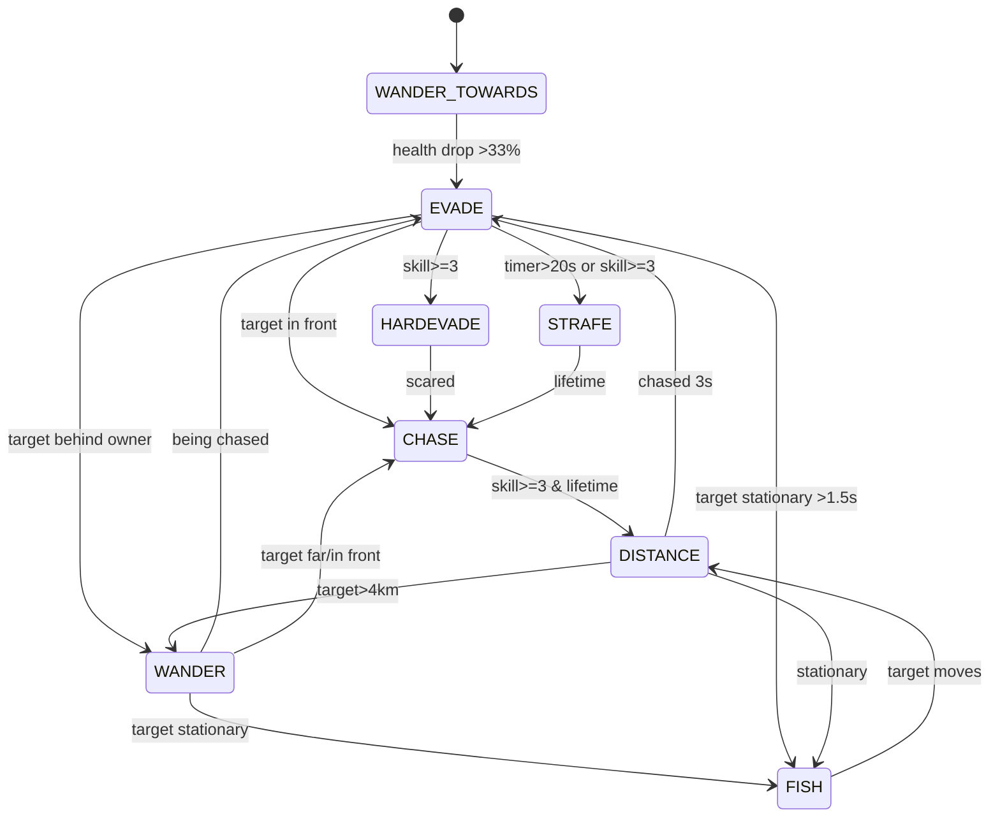

# 06 — AI, Behaviours, Navigation, and Reusable Crew-AI Patterns

**Scope:** Rodina 1.6.2's ship and character AI: how a behaviour is chosen, what data it consumes, which transitions are actually active, how the engine mover is used, and which ideas transfer to NPC ships and future crew AI in Starfall. Static source only.

**Confidence tags:** `[C]` confirmed, `[I]` inferred, `[U]` engine-side/unresolved.

---

## 1. One-paragraph summary

Rodina uses a **one-active-behaviour** model. Every actor owns a dictionary of behaviour instances (`Player`, `Combat`, `Travel`, `Orbit`, `Follow`, `Investigate`, …). Each AI tick, a per-class `GetBehaviorFunc` returns `{Name, TargetID, LeaderID}`, the actor switches behaviour if it changed, and the active behaviour's `ComputeMovement()` fills a movement request. For ships, that request is the shared `PilotInterface` consumed by `EGVehicle:ApplyMovement`; for characters, it is an engine `SetMoveState` table. The **engine mover** (ActionMove) does the actual `GOTO`/`ORBIT`/`FACING`/`FORMATION` navigation and obstacle avoidance; Lua mostly chooses goals and states. The most complete Lua state machine is ship `Combat`; `Travel`, `Orbit` and `Follow` have their transition `Update()` bodies **commented out** in 1.6.2, so their initial movement orders run but their state changes do not. Character AI (xeno combat, wander) has active room/door logic and is the better model for crew AI.

---

## 2. The behaviour framework

### 2.1 Classes and lifecycle

`EGBehavior` (`Gameplay/EGBehavior.lua:3-83`):

| Member | Meaning |
|---|---|
| `State` | string, initial `"NONE"` |
| `StateTimer`, `StateLifetime` | per-state timers |
| `Owner` | the actor |
| `Gear` | default 2 |
| `Enter(info)` | initialise from selection info |
| `Exit()` | cleanup |
| `Update(dt)` | state transitions, targeting, firing decisions |
| `ComputeMovement(pilotInterface, dt)` | write movement intent |
| `IsFinished()` | return true to be deselected |
| `SetStateColor(color)` | debug visualisation hook (empty in shipped build) |
| `HandleAvoidanceSensation(sense)` | callback from engine sensors |

`EGActor:ChooseBehavior/EnterBehavior` (`EGActor.lua:57-93`) implements the switch: if the new behaviour differs from `CurrentBehavior`, `Exit` the old, assign, `Enter` the new. `EGActor:UpdateAI` calls `ChooseBehavior`, then `CurrentBehavior:Update`, and if `IsFinished()` exits and clears (`:32-54`). `EGVehicle:UpdateAI` is nearly identical but gates on `self.Piloted` (`EGVehicle.lua:490-512`).

**There is no behaviour stack, no utility scoring, and no parallel behaviours.** Priorities are encoded entirely in `GetBehaviorFunc`.

### 2.2 Selection

`EGGetNextBehaviorScout` (`Gameplay/EGPlan.lua:5-34`):

1. If `Engine:IsPlayerControlled()` → `Player` (commented out block, but the player ship uses a different function).
2. If a combat target exists → `Combat` with `TargetID`.
3. If the ship is a group member and not leader → `Follow` with `LeaderID`.
4. If a current planet exists → `Travel` (target chosen lazily in `Enter`).

`EGGetNextBehaviorPlayer` (`:37-65`) returns `Combat`/`Travel` only in `DebugControlPlayer`; otherwise always `Player`.

Group membership is a simple `EGShipGroup` set with a leader ID and a shared combat target ID (`EGShipGroup.lua:3-52`). There is no formation slot data; `Follow` uses the current relative offset as its formation offset (`EGBehaviorFollow.lua:39-46`).

### 2.3 The engine mover contract

`EGVehicle:GetActionMove()` returns `self.Engine:GetMover()` (`EGVehicle.lua:1967-1969`). Behaviours set fields on this object, then `EGBehavior:ComputeMovement` calls `actionMove:Update(dt)` and copies outputs into the pilot interface.

Field vocabulary observed across behaviours:

| Field | Used by | Meaning |
|---|---|---|
| `MoveType` | all | `"GOTO"`, `"FACING"`, `"ORBIT"`, `"ORBIT_STRAFE"`, `"FORMATION"` |
| `MoveTargetID`, `FaceTargetID` | all | entity targets |
| `MoveTargetOffset` | Travel/Investigate/Follow | local offset around target |
| `MoveTargetAttractionFactor` | all | positive = approach, negative = retreat |
| `MoveTargetRadiusSpeed0/1` | Travel/Combat | inner/outer arrival radii mapped to speed |
| `MoveTargetBrakeRadius`, `MoveTargetBrakeHardness` | Investigate | explicit braking |
| `MinHeight0/1`, `MinHeightAvoidanceFactor` | Travel | terrain/height avoidance |
| `RandomChange`, `RandomFactor` | all | wander/jitter |
| `LeadTarget` | Combat | aim at predicted position |
| `Clutch` | CombatSphere | request coast |
| `AvoidanceDelegate`, `MoveTargetAvoidanceFactor`, `ProjectileAvoidanceFactor` | Combat/Investigate | sensor callback routing |
| `MovementSpeedMult`, `RandomDirRange`, `RandomDirDecay` | character panic | character mover only |

This is an **engine-defined behaviour-tree/motion-planning DSL**, not a Lua implementation. Starfall should define its own smaller `NavigationRequest` and not attempt to mimic these fields exactly.

### 2.4 Sensors

`EGBehavior:ComputeMovement` adds three sensors every frame for high-process ships (`EGBehavior.lua:62-64`):

- `AVOIDANCE_SENSOR` at local `(0,300,0)`, radius `200`.
- `PROXIMITY_SENSOR` at `(0,0,0)`, radius `200`.
- `ATTENTION_SENSOR` at `(0,0,0)`, radius `1000`.

The engine calls `HandleAvoidanceSensation(sense)` on the active behaviour when something is sensed. Combat uses it to break off when it senses its target (`EGBehaviorCombat.lua:442-452`); Investigate uses it to stop approaching (`EGBehaviorInvestigate.lua:105-111`). There is no Lua-side raycast, vision cone, or pathfinding.

---

## 3. Ship behaviours

### 3.1 Player

`EGBehaviorPlayer` (`:1-237`) is not "AI" but is part of the same interface:

- `Update` only checks weapons, headlight, gear shifting, and the pilot menu when the ship is player-controlled (`:18-31`).
- `ComputeMovement` reads `MOVE_SHIP` and `LOOK_SHIP`, handles free-look, autolevel, and jetpack freeze (`:206-237`).
- Gear shifting is a small state machine: hold `CLUTCH`, press `SHIFT UP/DOWN`, release both to commit; invalid gears play a grind sound and force the next valid gear (`:97-159`).
- Weapon firing is only allowed in gear ≤ 2 and below `2 × DragSpeed` (`:76-93`).

This is the only behaviour that is guaranteed to be complete in 1.6.2, because the player uses it every frame.

### 3.2 Combat (ship)

The richest active FSM (`EGBehaviorCombat.lua`).

**Targeting** (`:15-37`): scan `Engine:GetLocalActors`, choose the last player-controlled actor with health > 0. If no target, use the ship group's shared combat target (`:1833-1838` in `EGVehicle`).

**Entry** (`:39-51`): `SetPiloted(true)`, store `TargetID`, `EnterState("DEFAULT")` → `"WANDER TOWARDS"`, and publish the target to the ship group if none.

**States** (`:57-185`):

| State | Mover request | Notes |
|---|---|---|
| `WANDER` | GOTO, attraction 0, random 0.35 | drift/scan |
| `WANDER TOWARDS` | GOTO, attraction 0.75, random 0.25 | default |
| `DISTANCE` | GOTO, attraction −0.75, random 0.5 | retreat |
| `CHASE` | GOTO, lead target, radius 0→1400, attraction 0.8 | lifetime 2–3 s |
| `FISH IN BUCKET` | GOTO, lead target, radius 0→1400, attraction 1 | punish stationary target |
| `EVADE` | GOTO, attrition −0.01 to −0.15 | break lock |
| `HARDEVADE` | GOTO, attraction −0.01 | skill ≥ 3 evade |
| `STRAFE` | FACING + GOTO target offset 0 | orbit/strafe |
| `REVERSE` | GOTO + facing | legacy/unused? (EnterState includes it, Update does not) |
| `CLOSE` | **error** (`:105-106`) | dead state |

**Per-tick logic** (`:188-389`):

- Updates target validity, `SetInCombat`, timers.
- Measures target distance, target-forward and owner-forward geometry.
- Tracks target "stationary time": if target movement strength < 0.5 or clutching below 65% of its `MoveSpeed`, accumulate; clutch reduces accumulation to 5%; otherwise reset.
- Tracks `TargetImmuneTime` if the target is already locked by someone else.
- Forces `Gear = 2`.
- Fires missiles at > 4,000 m.
- Fires guns when the target is in front (`targetForward > 0.975`) and either the target is "pinned" (difficulty > 0.33 and stationary > 0.25 s) or a 20% random chance.
- Transitions:
  - WANDER: if being chased → EVADE; if target far or in front → CHASE (or WANDER TOWARDS if immune); if target stationary → FISH IN BUCKET.
  - WANDER TOWARDS: `CheckScared`.
  - EVADE/HARDEVADE: missiles; if target in front → CHASE/WANDER; if owner forward < 0 → WANDER; stationary target → FISH; `CheckScared`; after 20 s (difficulty ≥ .25) → STRAFE; high skill after 10 s → STRAFE; high skill EVADE → HARDEVADE.
  - DISTANCE: if being chased for 3 s → EVADE; target > 4,000 m → WANDER; stationary target → FISH.
  - CHASE: high skill after lifetime → DISTANCE; calls `target:OnTargetLock(owner)`.
  - FISH IN BUCKET: target lock; if target starts moving → DISTANCE.
  - STRAFE: after lifetime → CHASE.
- `CheckScared`: if health dropped > 33% since state entry, cycle EVADE ↔ HARDEVADE or enter EVADE (`:419-434`).
- `CheckStrafe`: geometry test for a side-on target within 500 m (`:392-416`).
- `CheckReverse` always returns false (`:437-439`).
- `HandleAvoidanceSensation`: if the sensed entity is the target, force DISTANCE for 3 s (`:442-452`).
- `IsFinished`: true if target missing or dead (`:454-467`).



**Variants:**

- `EGBehaviorCombatSphere` (`EGBehaviorCombatSphere.lua`): `CHASE` → `"ORBIT_STRAFE"` at 3,000–5,000 m; alternates `CHASE`/`CHASE_CLUTCH` every 1 s; designed for spherical ships.
- `EGBehaviorCombatBattleship` (`EGBehaviorCombatBattleship.lua`): `AIM_FIRE_MISSILES` at 0–1,400 m, attraction 0.8; `AIM` at 5,000–6,000 m; focuses on missiles.
- Several state assignments in the base class call `error()` for impossible states (`CLOSE`, `LOOKAT` in Investigate); this is a defensive assertion, not a used path.

### 3.3 Travel

`EGBehaviorTravel` (`EGBehaviorTravel.lua`):

- `Enter`: `SetPiloted(true)`, target = supplied `TargetID` or `planet:GetClosestDebrisID(owner)`, `EnterState("EXIT ATMOSPHERE")`.
- `EnterState`:
  - `EXIT ATMOSPHERE`: GOTO planet, attraction −0.75, random 1/0.5 (fly outward).
  - `APPROACH`: GOTO target, attraction 1, radii 500/1000, min height 300/1200.
  - `LINGER`: GOTO target, attraction 1, radii 500/1000, min height 150/300.
  - `ORBIT`: ORBIT planet with target position offset, radii `Radius + AtmosphereAltitude + 150 km/200 km`, random change 10.
- `Update`: **entire body commented out** (`:116-176`). It still increments `StateTimer`, but the transition logic (`EXIT ATMOSPHERE`→`ORBIT` when altitude > atmosphere, `APPROACH` when near, `LINGER` when on target, `LINGER`→new target after 60 s, `ORBIT`→`APPROACH`) is dead code.
- `IsFinished` always false.

**Consequence:** a ship entering Travel sets one movement order and never changes it through Lua. The engine mover may still satisfy it, but the intended multi-phase travel behaviour is not active in 1.6.2. Do not describe Rodina's AI travel as a working multi-state system.

### 3.4 Orbit

`EGBehaviorOrbit` (`EGBehaviorOrbit.lua`) is a copy of Travel with only `EXIT ATMOSPHERE` and `ORBIT`. `OrbitAltitude0/1` default 150/200 km, overridable per ship. Its `Update` is also fully commented out (`:95-117`). Only `EGShipBattleship` maps `Travel = EGBehaviorOrbit` (`EGDataShipBattleship.lua:29`); all other ships use `EGBehaviorTravel`.

### 3.5 Follow

`EGBehaviorFollow` (`EGBehaviorFollow.lua`):

- `Enter` stores `LeaderID`, `EnterState("FORMATION")`.
- `EnterState` sets `MoveTargetID = leader`, `MoveTargetOffset = leader:GetLocalVectorTo(owner)`, `MoveType = "FORMATION"`, attraction 0.
- `Update` is fully commented out (`:50-61`); the intended gear copy from the leader is dead.
- `IsFinished` false.

This is enough for a leader/follower formation if the engine mover understands `FORMATION` and the offset is the current relative position. It is not a formation-slot system.

### 3.6 Investigate

`EGBehaviorInvestigate` (`EGBehaviorInvestigate.lua`):

- `PickTarget`: finds the last player-controlled local actor.
- `Enter`: picks target, `EnterState("DEFAULT")` → `APPROACH`.
- `APPROACH`: GOTO target with a random offset above/side of it (x ±200, y 600–800, z ±100), radii 200±50 / 400±100, brake radius 500±100, brake hardness 0; faces target.
- `Update`: if within `arrivalRadius - 50` → `LOOKAT`; if beyond `arrivalRadius + 50` → `APPROACH`.
- `LOOKAT`: **calls `error("LOOKAT")`** (`:68`) and its mover setup is unreachable. So in 1.6.2, an investigator that reaches its target will throw a Lua error. This behavior appears unfinished/disabled.
- `HandleAvoidanceSensation` switches to `"DISTANCE"` (which has no `EnterState` branch) when it senses its target.

**Do not use Investigate as a model of a working scanner/investigation AI.** It is a stub with a deliberate assertion.

---

## 4. Character AI (the better crew-AI model)

Characters do not use `PilotInterface`. They call `owner.Engine:SetMoveState(actionState)` (`EGCharBehaviorWander.lua:114`; `EGCharBehaviorXenoCombat.lua:58-128`). The move state is a plain table with the same mover vocabulary (`GOTO`, `FACING`, radii, random factors). The engine character controller turns it into movement.

### 4.1 Wander / utility character

`EGCharBehaviorWander` (`EGCharBehaviorWander.lua`):

- States: `WANDER`, `GOTO`, `PANIC`, `FOLLOW_PLAYER`, `INSPECT`, `OPEN_DOOR`, `ENTER_DOOR`.
- On spawn, if the player is within 3 m, it enters `FOLLOW_PLAYER` for 25 s (a greeting), else WANDER (`:13-27`).
- WANDER: GOTO with attraction 0 and random factor 1.
- GOTO/FOLLOW/INSPECT: GOTO target with radii 0.5/1.
- PANIC: GOTO random, speed ×3, random direction range `(2,2,0)`, decay 1.
- OPEN_DOOR: GOTO door; once open factor ≥ 1 and target forward > 0.9 → ENTER_DOOR.
- ENTER_DOOR: GOTO through; once past the door → WANDER.
- It excludes `IsAirlockDoor` from casual opening (`:251-253`, `:272-274`), a small but important safety rule.
- Attention handling: if it sees a door within 1 m, it opens it; if it sees an inspectable object, it goes to inspect.

### 4.2 Xeno combat

`EGCharBehaviorXenoCombat` (`EGCharBehaviorXenoCombat.lua`):

- States: `WANDER`, `ATTACK`, `ATTACK SHOOT`, `ATTACK CHARGE`, `DODGING`, `RUN_AWAY`, `LOST_TARGET`, `FOUND_TARGET`, `OPEN_DOOR`, `ENTER_DOOR`.
- Target acquisition via engine attention/vision (`IsSeeing`, `IsSightTargetBlocked`), target distance/forward, and room identity (`GetCurrentRoom`).
- Random state selection uses per-class probabilities (`GetAttackShootingChance`, `GetAttackChargeChance`, `GetDodgeChance`) scaled by `dt`; shooting fires at random per-frame probability (`:306-322`).
- If the target is not visible and is in a different room for >2 s → `LOST_TARGET`; if visible → `FOUND_TARGET` → `ATTACK SHOOT` (`:349-359`, `:370-376`).
- Door logic is the same `OPEN_DOOR`/`ENTER_DOOR` pattern as Wander.
- Variants (Incinerator, Poacher, Replete, Scrapper, Soldier1/2/3, Trooper, Jetpack/Flier) override probabilities/range/weapon, not the state graph (`EGCharBehaviorXenoCombat*.lua`).
- `OnDamage` and `ForceCombat` hooks let external events push it into combat (`:445-471`).

**This is the strongest reusable AI architecture in the archive:** an explicit FSM with perception queries, room/door affordances, per-class tuning, and a clean separation between "decide" and "move."

### 4.3 Room/door affordances

Both character behaviours use:

- `Engine:GetCurrentRoom()` and `Engine:GetCurrentInterior()` to reason about space.
- `IsDoor`, `IsAirlockDoor`, `OpenFactor`, `Open(actor)` on door entities.
- `Engine:IsSeeing(id)`, `IsSightTargetBlocked(id)`, `GetAttentionEntity()` for perception.
- `GetDistanceBetween`, `GetForwardValue`, `GetTowardsForwardLOS` for geometry.

No grid/navmesh pathfinding is visible. The engine mover handles local navigation; the Lua layer handles doors and room transitions. For a ship with multiple rooms, this is enough for simple crew movement if the mover can path through doorways.

---

## 5. Group coordination

`EGShipGroup` is a flat set plus leader and shared target (`EGShipGroup.lua`). `EGVehicle:CreateChildren` creates follower ships in a random cube ±1,000 m around the leader, assigns the same group, sets `PersistenceProfile = "PersistenceVehicleFollower"` with `ResetPosition = true` after 300 s (`EGVehicle.lua:1977-2001`; `_work/persistence_notes.md`). On leader death, all group members are marked for destruction (`EGVehicle.lua:194-210`).

There is no squad tactics, no role assignment, and no shared formation slot. `Follow` uses the current relative offset, so followers keep whatever spacing they had when the behaviour started. Combat shares only a target ID (`EGBehaviorCombat.lua:47-50`).

This is a minimal, understandable coordination layer. For Starfall crew AI, a richer role/seat/station assignment is needed; see `08`.

---

## 6. What is actually active in 1.6.2

| Behaviour | `Update` transitions | Movement order | Verdict |
|---|---|---|---|
| Player | active | from input | complete |
| Combat | active | from mover | complete |
| CombatSphere | active | `ORBIT_STRAFE` | complete variant |
| CombatBattleship | active | `AIM`/`AIM_FIRE_MISSILES` | complete variant |
| Travel | **commented out** | one initial `EXIT ATMOSPHERE` order | partial |
| Orbit | **commented out** | one initial `EXIT ATMOSPHERE` order | partial |
| Follow | **commented out** | one `FORMATION` order | partial |
| Investigate | active, but `LOOKAT` throws `error()` | `APPROACH` only | broken/stub |
| Character wander | active | `SetMoveState` | complete |
| Character xeno combat | active | `SetMoveState` | complete |

The "commented out" bodies are wrapped in `---[[ … --]]`, which is a Lua long comment opened by a minus-prefixed double bracket. This is easy to miss when skimming; it is confirmed at:

- `EGBehaviorTravel.lua:116` … `:176`
- `EGBehaviorOrbit.lua:95` … `:117`
- `EGBehaviorFollow.lua:51` … `:61`

**Implication for the reference library:** earlier summaries that describe Rodina's AI travel/orbit as a working multi-state machine are overstating the shipped code. The *design* is visible; the *runtime* is largely delegated to the engine mover.

---

## 7. Reusable architecture for Starfall

### 7.1 Keep the good shape

1. **One active behaviour per agent.** A dictionary of behaviours + a selector function is enough. It is debuggable and cheap. Add a stack only where interrupt/resume is genuinely needed (e.g. combat interrupting a scripted conversation).
2. **Separate decision from actuation.** Behaviour produces a `NavigationRequest`/`PilotCommand`; the vehicle/character consumes it. Never let AI code write `global_position` or thruster state directly.
3. **Use an explicit FSM with named states and a transition table.** Rodina's combat FSM is readable because every state has a name, a movement request, and a set of arrows. Do the same with a `State` enum and a `match` in `_process`/`_physics_process`.
4. **Put perception behind queries.** `can_see(target)`, `distance_to(target)`, `current_room`, `door_in_front()` — not ad-hoc raycasts scattered through states.
5. **Per-class tuning as data.** Rodina's xeno variants override probabilities and ranges, not code. Use `Resource` subclasses or exported dictionaries.
6. **Do not copy the engine mover's field soup.** Define a small, typed `NavigationRequest` (target, desired range, facing, speed scale, avoid, brake) and let a `ShipPilot` or `CharacterLocomotion` interpret it.
7. **Hysteresis everywhere.** Rodina uses it for walkway speeds and target state transitions; Starfall should use it for enter/exit ranges, door states, and AI target acquisition.

### 7.2 Add what Rodina lacks

- **Role assignment** for crew: pilot, gunner, engineer, medic, passenger; a `CrewRole` resource and a `Station` binding.
- **Seat/station reservation** so two NPCs do not target the same seat.
- **Interruptible tasks** with a small task queue (go to, sit, operate, repair, return).
- **A real navigation graph** for interiors: room/portal nodes, door costs, occupancy, and a path request queue. Rodina delegates this to the engine; Starfall should own it so it can be debugged and replicated.
- **Perception memory** (last seen position, confidence, alert level) instead of immediate target loss.
- **Squad/crew blackboard** for shared targets, hazards, and commands.
- **Deterministic AI decisions** where multiplayer matters: seeded decision RNG, server authority.

### 7.3 Suggested Godot shape

```text
Agent (CharacterBody3D or Ship)
 ├── BehaviorController (Node)
 │    ├── behaviors: Dictionary[String, Behavior]
 │    ├── selector: Callable
 │    └── current: Behavior
 ├── Perception (Node)
 │    ├── can_see(target) -> bool
 │    ├── visible_targets() -> Array
 │    └── last_known_positions
 ├── Locomotion (Node)
 │    ├── request: NavigationRequest
 │    └── apply(delta)
 └── Blackboard (Resource/Node)
      ├── target_id, alert_level, home, role, seat
```

`Behavior` is a `Resource` or `RefCounted` with `enter(agent)`, `exit()`, `tick(delta)`, `build_request() -> NavigationRequest`, `is_finished()`.

For ships, the request is translated into Starfall's existing `Ship` inputs (thrust vector, target angular velocity, boost), not into a replacement flight model.

---

## 8. Evidence summary

| Claim | Evidence | Confidence |
|---|---|---|
| One active behaviour, switched by `GetBehaviorFunc` | `EGActor.lua:57-93`; `EGPlan.lua:5-65` | C |
| Ship and player share `PilotInterface` | `EGBehavior.lua:57-83`; `EGBehaviorPlayer.lua:206-237`; `EGVehicle.lua:594-620` | C |
| Engine mover owns navigation | `EGVehicle.lua:1967-1969`; `actionMove` setters throughout | C for API, U for implementation |
| Sensors and avoidance callback | `EGBehavior.lua:62-64`; `EGBehaviorCombat.lua:442-452` | C |
| Combat FSM states and transitions | `EGBehaviorCombat.lua:57-467` | C |
| Combat variants | `EGBehaviorCombatSphere.lua`; `EGBehaviorCombatBattleship.lua` | C |
| Travel/Orbit/Follow `Update` bodies commented out | `EGBehaviorTravel.lua:116-176`; `EGBehaviorOrbit.lua:95-117`; `EGBehaviorFollow.lua:51-61` | C |
| Investigate `LOOKAT` calls `error()` | `EGBehaviorInvestigate.lua:67-74` | C |
| Character AI uses `SetMoveState`, not `PilotInterface` | `EGCharBehaviorWander.lua:114`; `EGCharBehaviorXenoCombat.lua:58-128` | C |
| Character AI uses rooms/doors/perception | `EGCharBehaviorWander.lua:201-335`; `EGCharBehaviorXenoCombat.lua:284-409` | C |
| Group is flat set + leader + shared target | `EGShipGroup.lua:3-52`; `EGVehicle.lua:1977-2001` | C |
| No Lua pathfinding/raycast | absence in all behaviour files | C (absence) |
| Exact `ActionMove` semantics | engine C++ | U |

---

## 9. Cross-references

- Flight interface and gear model: `02_SPACESHIP_AND_PILOTING.md`
- Interior rooms/doors/airlocks: `03_INTERIORS_AND_AIRLOCKS.md`
- Seeded content for AI spawns: `05_PROCEDURAL_CONTENT.md`
- Starfall crew/AI roadmap: `08_STARFALL_IMPLEMENTATION_GUIDE.md`
- Evidence index: `09_SOURCE_EVIDENCE_INDEX.md`
