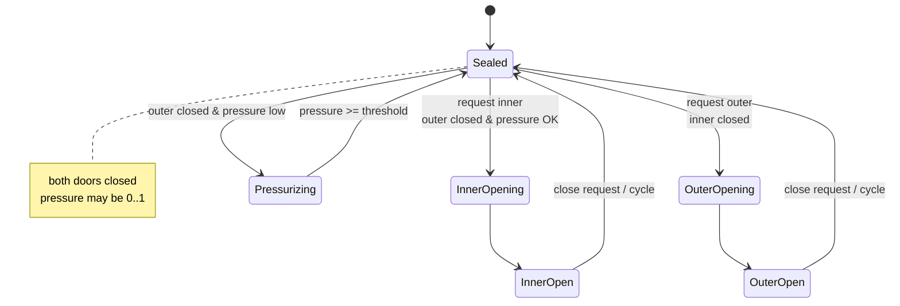
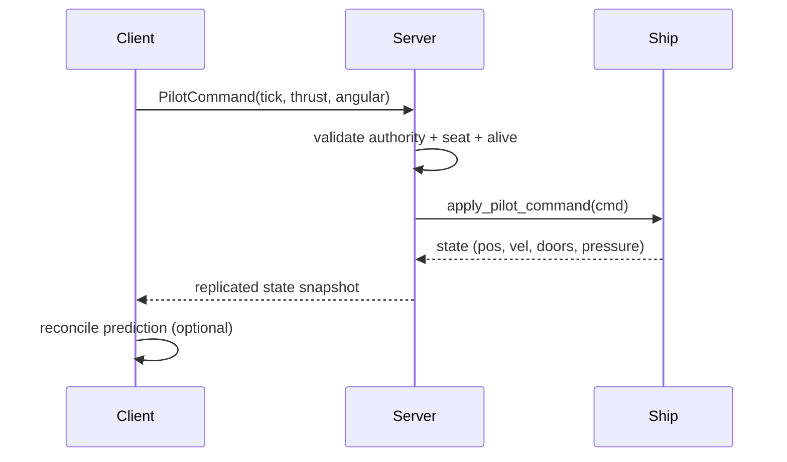

# 08 — Starfall Implementation Guide (Godot 4.7.2 Forward+)

**Purpose:** turn the Rodina findings into a safe, incremental plan for the existing Starfall project. This is a design brief, not an implementation. It deliberately preserves Starfall's working flight, planet, and on-foot systems.

**Project root inspected:** `/Users/arielbowyer/starfall`
**Engine:** Godot 4.7.2, Forward+, Jolt Physics (`project.godot`).
**Current code size:** 10 GDScript files, ~2,400 lines; one scene (`scenes/main.tscn`); one planet addon (`addons/cuberact_planet`).

---

## 0. Ground truth: what Starfall already has

| Capability | Where | What it actually does |
|---|---|---|
| 6DOF flight with inertia | `scripts/ship.gd:63-166` | Local-axis thrust, exponential flight-assist damping, speed cap with ease-back, mouse/key yaw-pitch-roll with response lerp |
| Altitude-scaled speed | `ship.gd:106-109` | `clamp(distance_to_terrain / cruise_altitude, 1, 50)` |
| Landing assist + terrain collision | `ship.gd:115-149` | Limits descent near ground; pushes the ship out of terrain and cancels downward velocity; support-point feet |
| Landing detection | `ship.gd:181-201` | `speed < 1` and `ground_gap() < 0.5`, with per-frame cache |
| On-foot pilot | `scripts/pilot.gd` | `SEATED / INSIDE / OUTSIDE`; F sit/stand; V cockpit; ship-local walking; spherical gravity; slope blocking; animation state |
| Walkable cabin | `scripts/ship_cabin.gd` | Runtime Quaternius shell, 4 m grid, two rooms + airlock, rectangular walkability, obstacles, inner/outer door interlock, walkway deploy/fit |
| Chase/cockpit camera | `scripts/chase_camera.gd` | Follows target with rotational lag, right-mouse orbit, first-person rigid mode, origin shift via `PlanetCamera` |
| Chunked planet | `addons/cuberact_planet` | Cube-sphere quadtree, CPU noise, CPU `get_terrain_height`/`get_distance_to_terrain`, atmosphere shell, shader terrain |
| HUD | `scenes/main.tscn` | One `Label` for speed/state; no real HUD system |
| Input | `project.godot` | thrust, yaw, roll, strafe, up/down, boost, interact, toggle_view |

**What Starfall does not have:** AI piloting, multiple seats/stations, pressure/airlock state beyond a door interlock, save/load, procedural POIs, multiple planets, crew roles, multiplayer, enemy AI, inventory, or a data-driven item system.

The plan below builds on what exists. It does **not** replace `ship.gd`'s flight model.

---

## 1. Non-negotiable constraints

1. **Preserve `Ship` flight.** Add an adapter/command layer; do not rewrite `_apply_thrust`, `_apply_rotation`, `_assist_landing`, `_collide_with_terrain`, or `ground_gap`.
2. **Preserve the current player feel.** `Pilot` already has a coherent on-foot model. Extend it with explicit states and occupancy; do not replace it with a generic character controller.
3. **Keep the cabin working.** Refactor `ShipCabin` incrementally: first add stable IDs/occupancy, then a room graph. Never break the current airlock/walkway until the replacement has parity tests.
4. **One authoritative state per concern.** Player mode, pilot authority, seat occupancy, door state, pressure, and save state each need exactly one owner.
5. **Server/host authority from day one** if co-op is planned. Even in single-player, route state changes through the same controller APIs so replication can be added later.
6. **No Rodina code or assets.** All names/structures below are original designs informed by concepts, not copied implementations.

---

## 2. Priority 1 — Shared pilot-control interface (player + AI + remote + scripted)

### 2.1 Current Starfall capability

`Ship` reads input directly in `_process` (`ship.gd:63-70`). There is no abstraction between "who wants to fly" and "how the ship flies". The pilot script calls `ship.set_process(false)` when standing up (`pilot.gd:107-108`), so unpiloted ships simply freeze. That is fine for a single-player prototype but blocks AI, crew, remote piloting, and multiplayer.

### 2.2 What Rodina shows

`EGBehaviorPlayer:ComputeMovement` and `EGBehavior:ComputeMovement` fill the same `PilotInterface`; `EGVehicle:ApplyMovement` is the only consumer (`02`, evidence there). The interface is a plain table with gear, move, move-lock, face/turn, clutch, desired velocity, and linear lock. Control authority is separate from camera target (`EGGame.lua:250-284`).

### 2.3 Design principle

**Separate intent from actuation.** A pilot source produces a command; the ship consumes it. The ship's flight model remains exactly as it is.

### 2.4 Recommended design

New files:

```text
scripts/piloting/pilot_command.gd        # Resource or RefCounted
scripts/piloting/pilot_source.gd         # abstract interface (class_name PilotSource)
scripts/piloting/player_pilot_source.gd  # reads Input
scripts/piloting/ai_pilot_source.gd      # wraps a NavigationRequest/AI brain
scripts/piloting/scripted_pilot_source.gd
scripts/piloting/pilot_controller.gd     # owns the active source, authority, seat
```

`PilotCommand` fields (all optional except the timestamp):

```gdscript
class_name PilotCommand extends RefCounted
var thrust: Vector3          # local X right, Y up, Z forward; -1..1
var angular: Vector3         # local pitch, yaw, roll rate demand; -1..1
var boost: bool
var brake: bool
var gear: int                # 0..4, optional; 4 = travel/warp later
var face_target: Node3D      # optional: point at this
var aim_target: Node3D       # optional: weapons/utility
var lock_linear: bool        # freeze translation
var source_id: StringName
var tick: int                # for reconciliation/debug
```

`PilotSource` contract:

```gdscript
func poll(delta: float) -> PilotCommand
func can_take_control() -> bool
func on_control_granted() -> void
func on_control_revoked() -> void
```

`PilotController` (child of `Ship`):

- `active_source: PilotSource`
- `authority_id: int` (peer id or `0` for local)
- `seat: Seat`
- `request_control(source, seat) -> bool` (validates occupancy/alive/authority)
- `release_control(source)`
- Emits `control_changed(old, new)`, `control_request_denied(reason)`.

`Ship` gets **one** new entry point:

```gdscript
func apply_pilot_command(cmd: PilotCommand, delta: float) -> void:
    # map cmd.thrust/angular/boost to the existing input fields, then call
    # the existing _apply_thrust/_apply_rotation/_assist_landing/_collide_with_terrain
```

Recommended internal change: replace direct `Input.get_axis` reads in `_apply_thrust`/`_apply_rotation` with cached fields (`_thrust_input`, `_turn_target`, `_boosting`) that are set either by the player source or by `apply_pilot_command`. The existing math stays untouched.

Preserve the current behavior exactly when the player is the source: `PlayerPilotSource` should produce the same values `Input.get_axis` produces today, and the ship's processing order should remain `_apply_thrust → _assist_landing → _apply_rotation → move → collide`.

### 2.5 Integration points

- `Pilot` (the character) no longer calls `ship.set_process(false)` on stand-up. Instead it calls `ship.pilot_controller.release_control(self)`; if no source is active, `Ship` enters a `PARKED` mode that damps velocity to zero (or keeps `set_process(false)` for now, behind the controller).
- `Pilot`'s seat interaction calls `ship.pilot_controller.request_control(player_source, seat)`.
- Remote piloting calls the same API with a `RemotePilotSource`; it must not require the character to be in the seat.
- AI calls `request_control(ai_source, seat)` and behaves like any other source.

### 2.6 Implementation order

1. Add `PilotCommand` + `PilotSource` + `PlayerPilotSource`.
2. Refactor `Ship` to consume a command; keep a compatibility path that uses input if no controller exists.
3. Add `PilotController` and move `set_process`/parking logic behind it.
4. Add an `AIPilotSource` that simply holds a target point and produces thrust/face commands (no combat yet).
5. Add tests: command replay, mid-flight source swap, parked behavior, control denied when seat occupied.

### 2.7 Risks and regression tests

| Risk | Test |
|---|---|
| Flight feel changes | Record 10 s of player input as commands, replay through both old and new paths; positions/velocities must match within 1e-3 |
| Ship keeps flying after stand-up | Stand up at full speed; ship must not receive input; `PARKED` state must be explicit |
| Two sources fight | Attempt a second `request_control`; must be denied with a reason |
| Camera follows wrong actor | In cockpit view, camera target remains the ship; in external, same; no snap |
| Origin shift breaks | Fly 10 km from spawn; camera/planet LOD still correct after source swap |

**Priority:** immediately useful; foundational for everything else.

---

## 3. Priority 2 — Reliable walking/sitting/piloting transitions

### 3.1 Current Starfall capability

`Pilot` has a single `Mode` enum and ad-hoc transitions:

- `sit_down()` sets `SEATED`, position to seat, plays `Sitting_Enter`, `ship.set_process(true)`.
- `stand_up()` sets `INSIDE`, steps right, plays `Sitting_Exit`, `ship.set_process(false)`.
- `_step_off_ship()` → `OUTSIDE`; `_enter_ship()` → `INSIDE` when `can_board_from_outside`.
- `_apply_camera()` switches camera target/offset.

This works but conflates **posture** (standing/sitting), **location** (inside/outside), and **authority** (who flies). There is no seat registry, no animation lock, no cancel path, and no handling of a moving ship during transitions.

### 3.2 What Rodina shows

Piloting is a control/camera mode, not a seated state (`03`). The player entity persists inside the interior. First/third person swaps which entity owns camera vs control. There is no readable sit animation in the pilot flow; chairs are engine-side. The valuable idea is **orthogonal state axes**, not Rodina's exact model.

### 3.3 Design principle

Model three independent state machines, not one:

1. **Posture:** `STANDING`, `SITTING`, `SEATED`, `STANDING_UP` (animation/input lock).
2. **Location:** `EXTERIOR`, `INTERIOR`, `IN_TRANSIT` (boarding/walkway), with a room/seat reference.
3. **Authority:** `NONE`, `PILOT`, `REMOTE_PILOT`, `AI_PILOT`, `PASSENGER`.

A player can be `SEATED + INTERIOR + PASSENGER` (co-pilot seat), `SEATED + INTERIOR + PILOT`, or `STANDING + INTERIOR + NONE`. A remote pilot is `EXTERIOR + REMOTE_PILOT`. This is what makes crew roles and multiplayer tractable.

### 3.4 Recommended design

New files:

```text
scripts/player/player_state.gd        # RefCounted with three enums + current refs
scripts/player/player_state_machine.gd
scripts/interior/seat.gd              # Node3D: seat_id, role, enter/exit transforms
scripts/interior/seat_manager.gd      # occupancy, reservation
scripts/interior/interaction_area.gd  # Area3D + prompt
```

`Seat`:

```gdscript
class_name Seat extends Node3D
@export var seat_id: StringName
@export var role: StringName          # "pilot", "gunner", "engineer", "passenger"
@export var occupant: Node3D
@export var enter_offset: Vector3
@export var exit_offset: Vector3
@export var allowed_modes: Array[StringName]
signal occupied(actor)
signal vacated(actor)
```

`SeatManager`:

- `reserve(seat, actor) -> bool`
- `release(seat, actor)`
- `seat_for(actor) -> Seat`
- `nearest_free_seat(position, role) -> Seat`
- Emits `seat_reserved`, `seat_released`.

`PlayerStateMachine`:

- `try_sit(seat)`, `try_stand()`, `try_enter_interior(portal)`, `try_exit_interior(portal)`, `try_take_pilot(seat)`, `try_release_pilot()`.
- Each returns a `TransitionResult` (`OK`, `BLOCKED_OCCUPIED`, `BLOCKED_DOOR`, `BLOCKED_MOVING`, `BLOCKED_AUTHORITY`).
- Animation lock: `SITTING`/`STANDING_UP` disable movement and re-triggering; a cancel input during `SITTING` reverses to `STANDING_UP`.
- On `SEATED`, the character's global transform is derived from the seat each physics frame (`seat.global_transform * offset`), exactly as `_follow_seat` does now.
- On `STANDING`, set a safe exit position; if the exit point is blocked, try the alternate side or refuse with feedback.

Camera:

- `CameraRig` with modes `CHASE`, `COCKPIT`, `INTERIOR_SHOULDER`, `EXTERIOR_SHOULDER`.
- `CameraRig.set_mode(mode, blend_time)`; keep `ChaseCamera` as the implementation for chase/cockpit, add a shoulder mode or reuse the existing offsets.
- First-person cockpit: camera at seat eye offset, rigid to ship, FOV from ship speed/boost.
- Third-person: current chase behavior.
- Never hard-cut if a 0.15–0.25 s blend is possible; `ChaseCamera` already lerps rotation and FOV.

### 3.5 Implementation order

1. Add `Seat` nodes to `ShipCabin` at the existing `seat_position`; keep `pilot.gd` behavior by making the pilot seat the only seat at first.
2. Add `SeatManager` and route `sit_down`/`stand_up` through it.
3. Add posture animation lock and cancel.
4. Add `PlayerState` with location/authority fields; make `Pilot` read from it instead of the single enum.
5. Add a second seat (passenger) and verify occupancy/reservation.
6. Add camera blend.

### 3.6 Risks and regression tests

| Risk | Test |
|---|---|
| Player gets stuck in sit/stand animation | Cancel mid-transition; stand again; no duplicate animations |
| Seat occupied by two actors | Two requests in same frame; exactly one succeeds |
| Ship moves during sit | Sit while ship is moving at 50 m/s; player stays glued to seat; no drift |
| Exit point blocked | Place crate at exit; player uses alternate or gets a clear refusal |
| Camera clips through hull | Orbit camera in interior; camera pull-in must use `is_walkable` or a collision shape |
| Authority mismatch | Seat says PILOT but controller says AI; controller wins, seat UI explains |

**Priority:** immediately useful; prevents a class of bugs before crew/multiplayer.

---

## 4. Priority 3 — Interior and airlock state management

### 4.1 Current Starfall capability

`ShipCabin` has:

- Hardcoded `_rooms: Array[Rect2]` and `_obstacles`.
- `is_walkable`, `floor_height`, `can_board_from_outside`, `push_out_of_hull`.
- Inner/outer door open factors, a two-door interlock (`ship_cabin.gd:86-93`).
- Walkway deploy only when landed and unpiloted; ramp fitted to terrain at deploy start (`:171-177`).

This is a solid prototype. It lacks pressure, occupancy-aware doors, room identity, a portal graph, and takeoff interlocks.

### 4.2 What Rodina shows

Interior rooms have engine pressure and decompression force; the airlock computer has three flags; the intended interlock is visible but disabled; the walkway has a special animated motion type and hysteresis; boarding is engine entrance bounds (`03`). The useful lessons are the **state separation** and the **safety invariants**, not the implementation.

### 4.3 Design principle

**A door is a graph edge with state; an airlock is a two-edge subgraph with pressure and occupancy.** Do not model doors as free-floating props with booleans scattered across scripts.

### 4.4 Recommended design

New files:

```text
scripts/interior/interior_layout.gd     # Resource: rooms, portals, bounds, ship-local
scripts/interior/interior_room.gd       # Node3D: room_id, bounds/polygon, pressure, hazard
scripts/interior/interior_portal.gd     # Node3D: portal_id, room_a, room_b, door state
scripts/interior/airlock_controller.gd  # two portals + pressure + cycle
scripts/interior/pressure_system.gd     # per-room pressure equalisation
scripts/interior/occupancy.gd           # actor -> room/portal/seat
scripts/interior/boarding_controller.gd # exterior<->interior transitions
scripts/interior/walkway_controller.gd  # deploy/retract/fit/occupancy
```

`InteriorLayout` resource (ship-local):

- `rooms: Array[RoomDef]` with `room_id`, convex bounds (AABB or 2D polygon + floor/ceiling), `volume_m3`, `default_pressure`.
- `portals: Array[PortalDef]` with `portal_id`, `room_a`, `room_b`, `transform`, `width`, `height`, `kind` (`DOOR`, `AIRLOCK_INNER`, `AIRLOCK_OUTER`, `HATCH`, `OPEN`).
- `seats: Array[SeatDef]`.
- `spawn_points`, `exterior_bounds`.

`InteriorRoom`:

- `pressure: float` 0..1, `is_vacuum`, `hazard`.
- `occupants: Array[Node3D]`.
- `equalize(delta, connected_rooms)`.

`InteriorPortal`:

- `open_factor: float`, `locked: bool`, `is_airlock_door: bool`.
- `can_open()` checks: no occupant in doorway, other airlock door closed, pressure differential below threshold, no emergency lock.
- `request_open(actor)`, `request_close(actor)`.
- Emits `opening`, `opened`, `closing`, `closed`, `blocked(reason)`.

`AirlockController` state machine:



`PressureSystem`:

- Per-room scalar, initialized from `default_pressure` (1 inside a pressurised ship, 0 for a vacuum airlock when outer is open).
- Portals equalize connected rooms at a configurable rate; open exterior portals vent to 0.
- Decompression force on actors in a venting room: `force = direction * pressure_delta * area * k`, applied only when a portal to vacuum is open.
- Pressure affects: door opening permission, sound/fog, damage (optional), jetpack refill (Rodina uses pressure for this), and UI.

`Occupancy`:

- Tracks actor → room, actor → portal overlap, actor → seat.
- Updated by `Area3D` enter/exit or by a cheap position query each physics frame.
- Used by door closing, airlock cycle, boarding, and save.

`BoardingController`:

- `request_enter(actor, portal) -> TransitionResult`: checks walkway deployed/landed, outer door open, occupancy, authority; then moves the actor to the interior spawn and switches `PlayerState.location`.
- `request_exit(actor, portal)`: checks landed/walkway, outer door open, no pressure differential, then moves to exterior.
- Never teleport without an explicit state transition; play a short fade/step animation.

`WalkwayController`:

- States: `STOWED`, `DEPLOYING`, `DEPLOYED`, `RETRACTING`, `BLOCKED`.
- Deploy only when `ship.is_landed()` and `not piloted`; retract when `piloted` or speed > threshold (keep Starfall's current behavior).
- Sample terrain at the foot at deploy start (current `_fit_walkway_to_ground`), and re-fit if the ship shifts while deployed.
- Occupancy sensor: do not retract with an actor on the walkway; do not take off with the walkway deployed and occupied.

### 4.5 Takeoff/landing interlocks

Add explicit checks (Rodina lacks them; this is a Starfall improvement):

- Cannot take off while the walkway is deployed and occupied.
- Cannot take off while the outer airlock door is open; auto-close request or block with UI.
- Cannot release pilot control while the ship is in a state that requires a pilot (e.g. atmospheric entry) unless an AI/remote source takes over.
- Cannot open the outer door while the ship is moving above a small threshold; block with a clear message (Rodina only warns).
- Cannot cycle the airlock while the ship is accelerating hard; require docked/landed or low acceleration.

### 4.6 Minimal concept set (the reliable core)

If the full design is too much, implement only these nine:

1. `InteriorLayout` with rooms and portals.
2. `InteriorRoom.pressure`.
3. `InteriorPortal` with `open_factor`, `locked`, `airlock` flag.
4. `AirlockController` with the four-state cycle.
5. `Occupancy` for room/portal/seat.
6. `Seat` + `SeatManager`.
7. `BoardingController`.
8. `WalkwayController`.
9. `PlayerStateMachine` with posture/location/authority.

### 4.7 Implementation order

1. Add `Occupancy` and `SeatManager` without changing movement.
2. Add `InteriorLayout` and replace `_rooms`/`_obstacles` with data, keeping the same queries.
3. Add portal objects wrapping the existing doors; keep the current interlock for parity.
4. Add pressure as a scalar with no consequences; display it in HUD.
5. Add `AirlockController` and switch the door logic to it; test parity.
6. Add decompression force, vacuum damage (optional), and takeoff interlocks.
7. Add walkway occupancy and takeoff checks.

### 4.8 Risks and regression tests

| Risk | Test |
|---|---|
| Both airlock doors open | Randomized door requests for 10,000 frames; invariant must hold |
| Player crushed by closing door | Stand in doorway; door must refuse to close or push the player out |
| Pressure leaks through closed door | Close both doors with pressure 0; pressure must rise only when sealed |
| Takeoff with ramp down | Try takeoff with walkway deployed; must be blocked or auto-retract |
| Player falls through ship | Walk every room edge while ship moves/rotates; no fall |
| Save/load mid-airlock | Save with one door open; load must restore a legal state (close both or restore exact) |
| Moving ship interior | Walk inside while ship translates/rotates at speed; local position stable |

**Priority:** immediately useful for reliability; pressure can be a later milestone.

---

## 5. Priority 4 — Landing on uneven terrain

### 5.1 Current Starfall capability

`Ship` already does more than Rodina here:

- `_collide_with_terrain` checks the hull centre and four landing feet, lifts the ship out of the terrain, cancels downward velocity, applies ground friction (`ship.gd:133-149`).
- `ground_gap()` caches the minimum gap across centre/feet (`:193-201`).
- `is_landed()` is speed + gap (`:181-184`).
- `_assist_landing` limits descent near the ground (`:115-127`).

What is missing: slope-aware attitude, stable resting on a slope, landing gear compression, terrain-normal alignment, and a safe "cannot land here" condition.

### 5.2 What Rodina shows

Landing is contact-relative (`surfaceDistance <= TerrainContactSurfaceDistance + 1` and speed < 4, `EGVehicle.lua:2009-2047`). Auto-level is roll-only and only in atmosphere (`:1152-1198`). No snap, no pad, no upright assist. The ship can slide on slopes (friction 0.4, restitution 0.8). Buildings flatten terrain; ships do not.

### 5.3 Design principle

**Use support points, not the origin.** A ship rests on a plane defined by its lowest contact points; attitude should converge to that plane only when slow/near ground.

### 5.4 Recommended design

New `scripts/ship/landing_controller.gd`:

- Inputs: `ship.global_transform`, `planet`, `hull_clearance`, `landing_feet`, `ground_gap()`, velocity.
- Each physics frame while `altitude < feet_check_altitude`:
  - Sample terrain height/normal at centre and each foot.
  - Compute support plane from the three lowest feet (or a least-squares plane).
  - If `speed < slope_align_speed` and `ground_gap() < slope_align_height`, apply a small torque toward the plane normal (PD controller, max torque).
  - If the slope exceeds `max_landing_slope_degrees`, set `landing_allowed = false` and show a HUD warning; do not snap.
  - If landed and `speed < landed_speed`, optionally lock horizontal drift with a strong damping (but allow takeoff).
- Do not change `_collide_with_terrain`; let the landing controller adjust attitude and flags, and let the existing collision resolve penetration.

`Ship` API additions:

```gdscript
var landing_allowed := true
var landed := false
var ground_normal := Vector3.UP
func can_take_off() -> bool
func request_landing_gear() -> void
signal landed_changed(landed: bool)
signal landing_blocked(reason: String)
```

Support points:

- Keep the four `landing_feet`.
- Add `hull_probe_points` for the belly and wingtips if the hull can contact before the feet.
- Use a terrain query that returns both height and normal (currently `get_terrain_height` + finite difference).

### 5.5 Landing on a slope: recommended behavior

1. Approach with descent assist.
2. On first support contact, record contact points and plane.
3. If slope ≤ `max_landing_slope` (e.g. 25°), converge roll/pitch to the plane over 0.5–1 s, with a max angular rate; keep yaw free.
4. Once aligned, set `landed = true`, zero downward velocity, apply high friction.
5. If slope > max, remain `landed = false` and slide/allow takeoff; show "Too steep".
6. On takeoff, release the alignment torque immediately; do not fight the pilot.

This is more controllable than Rodina's free-slide model and fits Starfall's existing support-point collision.

### 5.6 Risks and regression tests

| Risk | Test |
|---|---|
| Ship jitters on slope | Land on 15°, 25°, 35° slopes; attitude settles within 1 s; no oscillation |
| Ship sinks through terrain | Land on a cliff edge with two feet over air; no penetration; ship tips or refuses |
| Landing on a boulder | Point query misses the boulder; use collision normals or a sphere cast; test |
| Takeoff blocked by alignment torque | Take off immediately after landing; torque must release; no fighting |
| High-speed touchdown | Land at 50 m/s; collision damage or bounce; no false `landed` |
| Moving planet | Land at different latitudes; local up/normal correct |

**Priority:** immediately useful; Starfall's current landing is close. Implement before POIs and pads.

---

## 6. Priority 5 — Deterministic procedural points of interest

### 6.1 Current Starfall capability

None. One planet, no POIs, no discovery, no persistence.

### 6.2 What Rodina shows

Proxy rings 10 km / 3.5 km / 100 m; seeded location/item list; capacity-limited gradual spawn; per-proxy discovery; save flags; building seeds saved; asteroid deterministic seeds (`05`). Exact PRNG is engine-side.

### 6.3 Design principle

**A POI is a seed plus a state, not a scene.** Generate data first, instantiate scenes only inside rings, save only state and seed.

### 6.4 Recommended design

New files:

```text
scripts/world/poi_definition.gd     # Resource
scripts/world/poi_instance.gd       # Resource/RefCounted, serializable
scripts/world/poi_manager.gd        # per planet
scripts/world/poi_node.gd           # scene proxy
scripts/world/poi_content.gd        # pure generation functions
scripts/world/seed_hash.gd          # stable hash/PRNG helpers
scripts/world/poi_catalog.gd        # registry of definitions
```

`POIDefinition`:

```gdscript
class_name POIDefinition extends Resource
@export var id: StringName
@export var display_name: String
@export var poi_type: StringName       # crash_site, mine, outpost, beacon, wreck, cave
@export var content_profile: StringName
@export var spawn_radius := 12000.0
@export var content_radius := 4000.0
@export var detail_radius := 1500.0
@export var discover_radius := 120.0
@export var despawn_radius := 15000.0
@export var interior_profile: InteriorProfile
@export var loot_profile: LootProfile
@export var enemy_profile: EnemyProfile
@export var requires_landing_pad := false
```

`POIInstance`:

```gdscript
class_name POIInstance extends Resource
@export var poi_id: StringName
@export var definition_id: StringName
@export var seed: int
@export var generation_version: int
@export var position: Vector3          # planet-local direction * altitude
@export var state: int                 # PLANNED/PROXY/SPAWNED/DETAILED/DISCOVERED/CLEARED
@export var discovered := false
@export var visited := false
@export var looted := false
@export var cleared := false
@export var spawned_ids: Array[int] = []
@export var interior_state: Dictionary = {}
```

`POIManager`:

- Owned by the planet; holds `catalog`, `instances`, `active_nodes`.
- `generate_planet(planet_seed)` creates `N` instances from the catalog with stable seeds; no nodes.
- `_physics_process` computes distance from the player and runs ring transitions with hysteresis.
- `activate_proxy(instance)`, `spawn_content(instance)`, `despawn_content(instance)`.
- Emits `poi_state_changed(instance)`, `poi_discovered(instance)`, `poi_content_ready(instance)`.

`POIContent`:

- Pure functions: `build_loot(seed, profile)`, `build_encounter(seed, profile)`, `build_interior(seed, profile)`.
- Use a local `RandomNumberGenerator` seeded from `hash(world_seed, planet_id, "poi", index)`; never global `randf`.
- Return data (arrays/dictionaries), not nodes.

### 6.5 Seed strategy

```text
world_seed (int)
planet_seed = stable_hash(world_seed, planet_id)
poi_seed(i) = stable_hash(planet_seed, "poi", i)
content_seed = stable_hash(poi_seed, "content", generation_version)
```

Use a documented stable hash (SplitMix64/PCG) implemented in `seed_hash.gd`, or Godot's `RandomNumberGenerator` with an explicit integer seed and a pinned algorithm. Do not rely on `hash()` of strings for save compatibility across engine versions.

### 6.6 Rings and hysteresis

| Ring | Enter | Exit | Action |
|---|---|---|---|
| Proxy | 12 km | 15 km | marker, icon, name if discovered |
| Content | 4 km | 6 km | loot, enemies, structures |
| Detail | 1.5 km | 2.5 km | interiors, physics props, high-detail meshes |
| Discover | 120 m on foot | — | mark discovered, reveal lore |

Tune per POI type. The key is separate enter/exit radii, as Rodina does for its walkway (75/500 speed²) and AI ranges.

### 6.7 Implementation order

1. `seed_hash` + unit tests for stability.
2. `POIDefinition` + a catalog of 3 types (wreck, beacon, outpost).
3. `POIInstance` + `POIManager` generate/plan, no nodes.
4. `POINode` proxy marker + discovery radius.
5. Content spawn at ring, simple loot/enemy placeholders.
6. Interior generation for one POI type.
7. Save/load of instance state.
8. Persistence/regeneration test across sessions.

### 6.8 Risks and regression tests

| Risk | Test |
|---|---|
| Same seed gives different layout | Run generation 100× in fresh processes; hash the output data; must match |
| Full planet loaded at once | Spawn 500 POIs; count active nodes; only ring-active nodes exist |
| POI pops in/out at ring edge | Fly back and forth across 4 km; hysteresis must prevent thrash |
| Discovery double-fires | Enter radius multiple times; signal exactly once |
| Save bloats | Save 100 discovered POIs; file size bounded; no per-decoration transforms |
| Godot version changes PRNG | Pin algorithm; test with a known seed/output fixture |

**Priority:** high value, but after flight/transitions/landing. Start with 3 POI types, not a full grammar.

---

## 7. Priority 6 — Terrain and landing-zone variety

### 7.1 Current Starfall capability

`TerrainNoise` has continental (large/medium), mountains (ridged), detail, micro layers; `terrain_height`, `sea_level`, `coast_width`, `detail_scale` (`addons/cuberact_planet/scripts/terrain_noise.gd:9-27`). One planet, one profile, no biome masks.

### 7.2 What Rodina shows

Per-planet height functions with domain warp, Voronoi base, plateau/mountain/crater bands; per-planet palettes; six-gate material blending; distance-widened bands; terrain flattening for buildings (`04`).

### 7.3 Design principle

**Parameterize the height function; separate shape, material, and placement.** Starfall already has the LOD/collision; add variety at the data and shader layers.

### 7.4 Recommended design

New `TerrainProfile` Resource:

```gdscript
class_name TerrainProfile extends Resource
@export var planet_seed := 0
@export var radius_km := 6378.0
@export var terrain_height_km := 16.0
@export var atmosphere_height_km := 222.0
@export var sea_level := -0.123
@export_group("Continents")
@export var continental_scale := 0.096
@export var continental_weight := 0.305
@export var warp_strength := 0.0
@export_group("Mountains")
@export var mountain_scale := 1.0
@export var mountain_octaves := 3
@export var mountain_height := 0.465
@export var mountain_sharpness := 4.0
@export_group("Craters/Plateaus")
@export var crater_density := 0.0
@export var crater_radius_range := Vector2(0.01, 0.08)
@export var plateau_strength := 0.0
@export_group("Biomes")
@export var biome_noise_scale := 0.02
@export var biome_thresholds: PackedFloat32Array
@export var biome_colors: Array[Color]
@export_group("LOD")
@export var lod_threshold_deg := 10.0
@export var max_lod_level := 16
```

`TerrainNoise` gains:

- `warp(direction)` using a derivative-noise vector.
- `voronoi_base(direction)` for plate-like lowlands (optional).
- `crater_field(direction)` with a few octaves of cellular noise / explicit crater list.
- `height(direction, profile)` combining bands with cross-fades.
- `normal(direction, profile)` via finite differences, matching the mesh.

Keep the CPU and GPU height functions in lockstep. Add a unit test that samples 1,000 random directions and compares CPU height to a GPU readback (or a reference GDScript implementation) within tolerance.

### 7.5 Landing zones and POI pads

Add `TerrainModifier` (engine-agnostic, CPU-side):

```gdscript
class_name TerrainModifier extends Resource
@export var center_dir: Vector3        # planet-local unit
@export var inner_radius_m := 30.0
@export var outer_radius_m := 150.0
@export var target_height := 0.0       # relative to base terrain
@export var blend_curve: Curve
func apply(base_height: float, direction: Vector3) -> float
```

`POIManager`/`TerrainManager` keeps a small list of modifiers and applies them in `get_terrain_height`. The shader must receive the same modifiers (uniform array) for visual parity. Limit to, say, 32 active pads; sort by distance.

Site scoring for pads:

- Sample a small grid around the candidate direction.
- Compute mean slope, max slope, curvature, and distance to water/POI.
- Reject if `max_slope > 20°` or `curvature` too high; otherwise place a pad and flatten.
- Use the score to choose among several candidate directions from the POI seed.

This is a Starfall improvement; Rodina only flattens around authored buildings.

### 7.6 Risks and regression tests

| Risk | Test |
|---|---|
| CPU/GPU height mismatch | 1,000 random directions; error < 0.5 m |
| LOD seams | Fly from orbit to surface; no cracks or popping beyond threshold |
| Craters break collision | Walk into a crater; collision matches visual |
| Pad z-fighting | Land on a pad; terrain and pad agree within 0.05 m |
| Profile swap changes seed | Same seed + same profile → same planet; different profile → different but deterministic |
| Performance | 500 POIs + 32 modifiers; frame time target |

**Priority:** later milestone for multi-planet; terrain variety is high-value after POIs.

---

## 8. Priority 7 — Saving and loading player, ship, and discovery state

### 8.1 Current Starfall capability

None. All state is in memory; quitting loses everything.

### 8.2 What Rodina shows

Two protocols (keyed `Encode/Decode`, versioned `Load`), save version 38, autosave on context changes, per-class persistence profiles, seed-based regeneration, `.egs` binary (`_work/persistence_notes.md`). The important lesson is not the format; it is the **separation of durable state, seed, and engine-owned entity transforms**.

### 8.3 Design principle

**Save decisions and seeds, not scenes.** Every saved field must be reconstructible or authoritative.

### 8.4 Recommended design

New files:

```text
scripts/save/save_game.gd        # Resource: versioned sections
scripts/save/save_manager.gd     # atomic write, autosave, load
scripts/save/save_migrations.gd
scripts/save/serializable.gd     # optional interface
```

`SaveGame` sections:

```text
meta:          save_version, game_version, created_at, play_time, world_seed
player:        mode, location (planet/ship/room/seat), transform, health, inventory, equipment
ship:          ship_id, transform (planet-local), velocity, angular_velocity,
               pilot_authority, seat_occupant, interior_state, landing_state
world:         current_planet_id, planet_seeds, discovered_planets
pois:          Array[POIInstance] (only non-default state)
discoveries:   stable IDs of discovered POIs/planets
settings:      only if not in user://settings.cfg
```

Stable IDs:

- `ship_id`: UUID or deterministic from world seed and ship index.
- `poi_id`: deterministic from planet seed and index.
- `room_id`, `seat_id`, `portal_id`: authored names in `InteriorLayout`.
- `entity_id` for placed objects: UUID; never reuse.

Serialization:

- Use `ResourceSaver`/`ResourceLoader` with a dedicated `.tres` or `.res`? For savegames, prefer JSON or a compact binary (`var_to_bytes`) with an explicit schema.
- JSON is human-debuggable and version-tolerant; binary is smaller/faster. For Starfall's scale, JSON + gzip is a good first choice.
- Write to `user://saves/<slot>.tmp`, `flush`, close, then `DirAccess.rename_absolute` to `<slot>.json`. Keep one backup `<slot>.bak`.
- Validate on load: schema version, required fields, checksum (SHA-256), bounds (position finite, seeds in range).

Migrations:

- `meta.save_version` integer; `save_migrations.gd` has `migrate_v1_to_v2(data)` etc.
- Never silently drop a section; log and use defaults.
- Keep `generation_version` for POIs and interiors; if content changed, regenerate rather than loading incompatible geometry.

Autosave:

- Triggers: entering/exiting pilot, sitting/standing, entering/exiting interior, landing/takeoff, discovery, POI state change, every N minutes.
- Throttle (Rodina's 20 s is a reasonable default) and never autosave while a modal UI is open or a transition is in progress.
- Autosave must be non-blocking or at least not during a frame-critical physics step; use a worker or defer.

### 8.5 What to save for the ship

- Planet-local position + orientation (not global) to survive origin shift.
- Linear/angular velocity in ship-local or planet-local frame.
- `PilotAuthority` (none/player/ai/remote), `seat_occupant`.
- Landing state: `landed`, `landing_allowed`, support plane normal, `walkway_state`.
- Interior state: per-room pressure, portal open factors, locked flags, seat occupancy, discovered/looted IDs.
- Do **not** save every crate/prop transform; regenerate from interior seed unless the player moved it. If the player can move props, save a diff keyed by stable prop ID.

### 8.6 Implementation order

1. `SaveGame` schema + `SaveManager` with one slot, JSON + atomic rename.
2. Save/load player transform, mode, ship transform, velocity.
3. Save/load seat/authority, doors, walkway, landing.
4. Save/load planet seed and discovered planets.
5. Save/load POI instances and discoveries.
6. Migrations + backups + corruption handling.
7. Autosave triggers + UI.

### 8.7 Risks and regression tests

| Risk | Test |
|---|---|
| Load teleports the player | Save standing in cabin, seated, piloting, outside; each loads to the same mode/position |
| Ship velocity lost | Save at 50 m/s, load; velocity and orientation match |
| Origin shift corrupts position | Save at 10,000 km from origin; load; position relative to planet correct |
| Save during transition | Request save during sit/board/airlock; must defer or save a legal state |
| Corrupt file | Truncate/checksum mismatch; load must fail gracefully and keep the previous save |
| Version migration | Load a v1 fixture in v2; all fields mapped or defaulted |
| Duplicate discovery | Save/load twice; discovery signal fires once |

**Priority:** immediately useful; implement before POIs so state has a home.

---

## 9. Priority 8 — Crew roles and multiplayer-friendly architecture

### 9.1 Current Starfall capability

Single player, one pilot seat, no NPCs, no stations, no authority model.

### 9.2 What Rodina shows

Single-player only. It has chairs/seat flags, a pilot station, an airlock computer, operations/scanners consoles, and a ship group for AI. It does **not** have crew roles, station assignment, or networking. The useful patterns are the **station** concept, the **control authority** split, and the **flat group** model (`06`).

### 9.3 Design principle

**Roles are data; authority is explicit; simulation is server-owned.** Do not encode "the player" as a singleton inside ship systems.

### 9.4 Recommended design

New files:

```text
scripts/crew/crew_member.gd       # Resource or Node: actor_id, role, skills
scripts/crew/crew_role.gd         # Resource: role_id, station_types, permissions
scripts/crew/station.gd           # Node3D: station_id, role, seat, console
scripts/crew/crew_manager.gd      # assignment, reservations, orders
scripts/net/ship_authority.gd     # owner peer, command validation
scripts/net/pilot_command_rpc.gd  # RPC wrapper
```

`CrewRole`: `pilot`, `gunner`, `engineer`, `medic`, `scientist`, `passenger`.
`Station`: `station_id`, `role`, `seat`, `control_mode` (`PILOT`, `TURRET`, `SYSTEMS`, `NONE`), `interaction_area`.
`CrewManager`: `assign(actor, station)`, `unassign`, `nearest_station(role)`, `orders` (follow, hold, repair, man station).
`ShipAuthority`: `owner_peer`, `can_command(peer, command)`, `validate(command)`, `apply(command)`.

Control flow for multiplayer:



Rules:

- Only the authority for a station can issue commands for that station.
- The server owns door/pressure/POI state; clients request, server confirms.
- `PilotCommand.tick` enables reconciliation and replay testing.
- Do not replicate per-frame transforms for every prop; replicate ship transform + interior state; clients derive local props.
- Use stable `station_id`/`seat_id`; never use node paths as network IDs.
- Late join: server sends `SaveGame`-like snapshot or a compact world state; client reconstructs from seeds + deltas.

### 9.5 Crew AI

Build on the ship behaviour pattern (`06`):

- `CrewBehavior` extends `Behavior`; `CrewManager` assigns a `Station`.
- `GoToStation`, `Sit`, `Operate`, `Repair`, `ReturnToSeat`, `FollowPlayer`.
- Navigation uses the interior room/portal graph (Priority 3) and the `CharacterLocomotion`.
- `CrewMember` has skills that affect station performance (repair speed, weapon accuracy, scan range).
- A crew member can take a seat and become `PASSENGER` or `GUNNER`, not `PILOT`, unless authorized.

### 9.6 Implementation order

1. `Seat`/`Station` data and `CrewManager` in single-player (no network).
2. A second seat and a gunner station; verify occupancy/authority.
3. Crew AI for one role (go to seat, sit, idle).
4. `ShipAuthority` abstraction with a local owner; no RPC yet.
5. Add RPCs and a listen-server test with two clients.
6. Replicate door/pressure/POI state; test late join.

### 9.7 Risks and regression tests

| Risk | Test |
|---|---|
| Two players claim pilot | Simultaneous requests; exactly one wins; loser gets a reason |
| Client flies without authority | Malformed RPC; server rejects; ship state unchanged |
| Late join desync | Join after 10 minutes; ship position, doors, pressure, POIs match |
| Crew AI blocks player | Player requests a seat an NPC is using; NPC yields or player gets a clear message |
| Reconnect | Disconnect/reconnect; authority and seat restored or released |
| Determinism | Same input commands on server produce same trajectory in replay |

**Priority:** later milestone; design the APIs now so single-player code does not need a rewrite.

### 9.8 Combat, inventory, and character data model (co-op correctness)

These are not new priorities, but they must be designed before weapons/crew are networked. Rodina’s data model is a useful warning.

**Teams.** Rodina has no team field. A projectile owned by a non-player passes through any `CharacterActor` that is also not the player; xeno shots cannot hurt xenos (`EGProjectile.lua:106-112`), and missile targeting is player-centric (`EGWeaponMissile.lua:94-147`). For Starfall:

- Every combatant has `team_id: int` and `faction_id: StringName`.
- A projectile carries `owner_id`, `team_id`, and `friendly_fire: bool`.
- Hit resolution asks `CombatRules.can_damage(attacker, target)`; never `is_player`.
- Test: xeno A shoots xeno B; player shoots crew; crew shoots player; friendly fire off/on.

**Inventory.** Rodina keeps a spatial grid ledger and a separate count ledger (`EGPlayerInfo.Inventory`), and some flows check both (`_work/items_combat_notes.md` §2). For co-op:

- One server-owned `InventoryComponent` with `{def: ItemDef, count: int, grid_pos: Vector2i, slot: StringName}`.
- Clients send `request_move`, `request_use`, `request_equip`; server validates and replicates.
- Ammo is debited server-side for every shooter, player or AI.
- Equipment active state is part of the same record, not a second native component.

**Weapons.** Use a single `WeaponDef` resource with `fire_style`, `cooldown`, `spread`, `projectile_count`, `projectile: ProjectileDef`, `ammo_type: ItemDef?`, `muzzle_slot`, `flare/charge/impact` effect refs, `inherit_owner_velocity`, and `team_policy`. Three projectile scenes (bullet, body, homing missile) consume it. Do not copy Rodina’s ship-weapon Lua: its `FireWeapon` body is commented out (`EGVehicle.lua:1660-1736`) and ship guns are engine-driven.

**Characters.** Rodina assembles bodies from named modules (`GetModuleEntities`) with native animation modules and no per-part hit zones. Robot parts are seed-selected, xeno parts use global `math.random` (`EGXenoBody.lua:20-28`), and robot `Seed` is re-randomized in `Init`, so bodies are not reproducible across sessions (`_work/items_combat_notes.md` §9). For Starfall:

- `CharacterDef` + `BodyPartDef` resources with named slot markers (`TorsoSlot`, `HeadSlot`, `ArmRightSlot`, …).
- Assembly is a pure function of `character_seed`; no global RNG.
- If hit zones are needed, define them as part metadata and resolve on the server.
- Test: same seed + same definition → identical part list and transforms across processes.

**Particles.** Treat effects as `ParticleEffectDef` resources keyed by `StringName`, with an `attach_effect(slot, def, intensity, transform)` API. Rodina’s `(slot, amount)` handle is a good pattern for engines, muzzle flares, and charge-up. Budget for many small emitters per ship (Rodina drives ~15 per hull) rather than one monolithic system.

**Buildings/POIs.** Derive “cleared” from live actor count, as Rodina does (`EGBuilding.lua:91-104`, `EGGame.lua:124-139`), or store a server-owned state that is robust to late joiners. Do not store a client-local `is_cleared` boolean.

---

## 10. Recommended file layout

```text
scripts/
├── ship/
│   ├── ship.gd                  # existing; add command consumer
│   ├── landing_controller.gd
│   └── ship_state.gd
├── piloting/
│   ├── pilot_command.gd
│   ├── pilot_source.gd
│   ├── player_pilot_source.gd
│   ├── ai_pilot_source.gd
│   └── pilot_controller.gd
├── player/
│   ├── pilot.gd                 # existing; become state-machine consumer
│   ├── player_state.gd
│   └── player_state_machine.gd
├── interior/
│   ├── ship_cabin.gd            # existing; keep visual construction
│   ├── interior_layout.gd
│   ├── interior_room.gd
│   ├── interior_portal.gd
│   ├── airlock_controller.gd
│   ├── pressure_system.gd
│   ├── occupancy.gd
│   ├── seat.gd
│   ├── seat_manager.gd
│   ├── boarding_controller.gd
│   └── walkway_controller.gd
├── world/
│   ├── poi_definition.gd
│   ├── poi_instance.gd
│   ├── poi_manager.gd
│   ├── poi_node.gd
│   ├── poi_content.gd
│   ├── seed_hash.gd
│   ├── terrain_profile.gd
│   └── terrain_modifier.gd
├── save/
│   ├── save_game.gd
│   ├── save_manager.gd
│   └── save_migrations.gd
├── crew/
│   ├── crew_role.gd
│   ├── crew_member.gd
│   ├── station.gd
│   └── crew_manager.gd
└── net/
    ├── ship_authority.gd
    └── pilot_command_rpc.gd
```

Resources in `resources/`:

```text
resources/ships/*.tres
resources/pois/*.tres
resources/terrain/*.tres
resources/interiors/*.tres
```

This is a target layout, not a mandate. Keep the current three scripts in place until their replacements have parity tests.

---

## 11. Milestones and ordering

| Milestone | Contents | Depends on | Risk |
|---|---|---|---|
| M0 | Baseline capture: record current flight/landing/cabin behavior as regression fixtures | — | low |
| M1 | `PilotCommand` + `PilotController` + player source; ship consumes; flight parity | M0 | medium |
| M2 | Seat/SeatManager + explicit posture/location/authority; camera modes | M1 | medium |
| M3 | InteriorLayout + Occupancy + portals; airlock parity | M2 | medium |
| M4 | LandingController slope alignment + interlocks | M1 | medium |
| M5 | SaveManager + M1–M4 state roundtrip | M1–M4 | medium |
| M6 | POI data + rings + 3 POI types + discovery | M5 | high |
| M7 | Pressure system + decompression + vacuum hazards | M3 | high |
| M8 | TerrainProfile + feature masks + pads | M6 | high |
| M9 | Crew roles/stations + one crew AI | M2/M3 | high |
| M10 | Networking authority + replication | M5/M9 | very high |

Do not start M6–M10 before M1–M5 are stable. The most common failure mode is adding POIs/crew on top of ambiguous control/authority state.

---

## 12. Things Starfall should deliberately do differently

| Rodina pattern | Starfall choice | Why |
|---|---|---|
| Gear/relative-time flight model | Keep current 6DOF; add optional travel mode later | Current model is working, simpler, and already tuned |
| Contact-relative landing | Support points + slope alignment | More robust on uneven terrain |
| No occupancy checks for doors | Occupancy-aware doors | Prevents crushing/softlocks, needed for crew |
| Global `AllDoorsOpen` pressure hack | Per-room pressure + portals | Correct, testable, multiplayer-friendly |
| Engine-owned navigation | Own room/portal graph + navigation requests | Debuggable, replicable, supports crew |
| Class-name-keyed discovery | Stable per-instance IDs | Avoids collisions, supports saves/network |
| One giant `.rsl` grammar | Small typed room templates + graph expander | Faster to build, easier to validate |
| `.egs` for everything | Distinct extensions for saves/cache/scripts | Prevents tooling confusion |
| No save migration | Versioned schema + migrations | Long-lived project |
| Single-player authority | Server/host authority from the start | Future co-op without rewrite |

---

## 13. What not to do

- Do not port `EGVehicle` or `EGBehavior` code into GDScript.
- Do not replace `Ship._apply_thrust`/`_apply_rotation` with Rodina's gear model.
- Do not make the player a `RigidBody3D` just because Rodina uses engine physics; Starfall's kinematic pilot is predictable and already works.
- Do not generate a full planet of POIs at load.
- Do not save every node transform; save seeds/state.
- Do not use `math.random`/global `randf` for content; use per-POI seeded RNG.
- Do not import `.egm`/`.egi`/`.rsl`/`.egu`/`.egs` assets.
- Do not implement networking by replicating every node; replicate state and commands.

---

## 14. Acceptance criteria for the whole plan

1. Player can walk, sit, pilot, stand, board, and exit without a softlock in 100 randomized transitions.
2. Player and AI can swap control of the same ship mid-flight with no teleport or velocity loss.
3. Both airlock doors can never be open at once; pressure never leaks through a closed door.
4. Ship lands on 25° slopes without jitter or sinking; refuses >35° with a clear message.
5. A POI generated from the same seed is identical across processes and saves.
6. Save/load roundtrips player, ship, doors, pressure, POIs, and discoveries; corrupt saves fail safely.
7. A second seat/station can be occupied by a crew member without breaking pilot authority.
8. All existing flight/landing/cabin regression fixtures still pass.

---

## 15. Cross-references

- Flight/pilot evidence: `02_SPACESHIP_AND_PILOTING.md`
- Interior/airlock evidence: `03_INTERIORS_AND_AIRLOCKS.md`
- Terrain/landing evidence: `04_PLANETS_AND_TERRAIN.md`
- POI/seed evidence: `05_PROCEDURAL_CONTENT.md`
- AI/crew evidence: `06_AI_AND_NAVIGATION.md`
- Formats/assets: `07_DATA_FORMATS_AND_ASSETS.md`
- Open questions: `10_OPEN_QUESTIONS.md`
